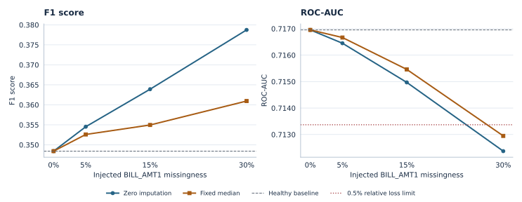
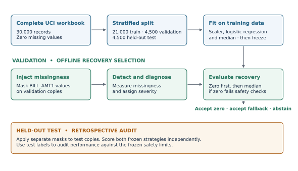
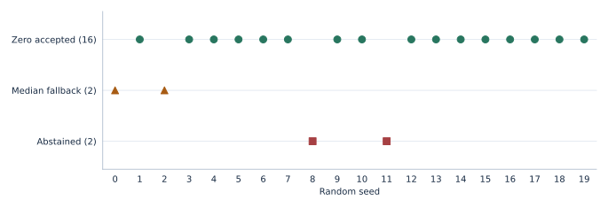

# Self-Healing Machine Learning (SHML)

**Automated Failure Detection, Model Recovery, and Safety Validation for Credit-Default Prediction**

## 1. Project Overview

This project investigates whether a machine learning system can automatically detect data-quality failures, diagnose their causes, evaluate recovery strategies, and safely accept or reject corrective actions.

The **UCI Default of Credit Card Clients** workbook used in this project contains no missing values. The research uses Logistic Regression as the baseline classifier and tests how SHML responds when researchers deliberately mask `BILL_AMT1` values in experimental copies.

At 15% injected missingness, the standalone recovery policy reproduced all 20 notebook decisions. It accepted zero imputation 16 times, selected median imputation twice, and abstained twice. [Seed-by-seed comparison](results/bill_amt1/integrated_vs_notebook.csv)

To reproduce the experiments, see [Running the Project](#13-running-the-project).

### Current Research Status

The following components have been implemented or experimentally evaluated:

- Dataset preprocessing and exploratory data analysis
- Healthy baseline model development
- Automated missingness detection and diagnosis
- Zero imputation, training-median fallback, and abstention in the standalone pipeline
- Comparative evaluation of zero, median, and regression imputation
- Controlled missingness experiments across five severity levels
- Statistical comparisons across 20 random missingness injection seeds
- Paired confidence intervals and recovery-performance visualizations
- Safety validation using a deliberately harmful recovery candidate
- Offline rejection and approved-state preservation
- Seed-by-seed comparison with the research notebook
- Held-out evaluation of both frozen recovery strategies

**Current focus:** Completing rigorous scientific validation of `BILL_AMT1` before expanding to other failure types.

**Streamlit dashboard:** [Open the live dashboard](https://d3s4h6tax9pxqy8t3f4ciu.streamlit.app/) · [See the previews and run it locally](#14-streamlit-dashboard)



---

## 2. Research Objectives

The project has six primary objectives:

1. Develop a machine learning baseline for credit-default prediction.
2. Detect and diagnose deliberately injected missingness.
3. Compare multiple recovery techniques and measure their effectiveness.
4. Implement a safety mechanism that accepts or rejects candidate repairs.
5. Evaluate reproducibility, statistical reliability, and the effects of failure severity.
6. Investigate model resilience, feature relationships, and subgroup robustness.

The overarching goal is to understand **when automated recovery is beneficial, when it is ineffective, and when the system should reject an attempted correction.**

## 3. Research Questions and Hypotheses

### Primary Research Question

To what extent can a self-healing machine learning system detect, diagnose, and respond to deliberately injected `BILL_AMT1` missingness while maintaining predictive performance, enforcing safety constraints, and producing reproducible results?

| Hypothesis | Research Focus | Current Assessment |
|---|---|---|
| H1 | Missingness detection and predictive degradation | Partially supported; degradation depends on the metric and recovery strategy |
| H2 | Diagnosis-guided recovery | The added benefit of diagnosis-guided strategy selection remains untested |
| H3 | Safety validation and rejection | Partially supported by harmful-candidate rejection and offline approved-state preservation |
| H4 | Missingness severity and feature relationships | Severity effects observed; contribution of feature redundancy requires further validation |
| H5 | Reproducibility and statistical reliability | Supported under tested configurations using deterministic experiments and repeated seeds |
| H6 | Subgroup robustness | Pending evaluation |

See the [hypothesis evaluation](docs/hypothesis_evaluation.md) for the evidence and limitations.

---

## 4. Dataset

**Dataset:** UCI Default of Credit Card Clients

**Prediction task:** Predict whether a customer will default on credit-card payment in the following month.

### Dataset Characteristics

| Attribute | Value |
|---|---|
| Observations | 30,000 |
| Predictors | 23 |
| Target | `default payment next month` |
| Problem type | Binary classification |
| Training observations | 21,000 |
| Validation observations | 4,500 |
| Test observations | 4,500 |
| Missing values in the source workbook | 0 |
| Main feature selected for simulated missingness | `BILL_AMT1` |

The source workbook and original data partitions are preserved. Development experiments mask values in copies of the validation features. The held-out evaluation applies its own masks to copies of the test features after the recovery strategies and safety thresholds are frozen.

---

## 5. Baseline Machine Learning Model

The baseline classifier uses **Logistic Regression** with standardized features.

### Healthy Validation Performance

| Metric | Score |
|---|---:|
| Accuracy | 0.808667 |
| Precision | 0.694767 |
| Recall | 0.240201 |
| F1-score | 0.356983 |
| ROC-AUC | 0.713025 |

**Primary evaluation metric:** F1-score

**Additional metrics:** Recall, precision, accuracy, and ROC-AUC.

The primary classification threshold is 0.50.

The healthy validation performance serves as the reference for measuring changes following data corruption and recovery.

---

## 6. SHML System Architecture

The SHML framework follows seven main stages.

### Stage 1 — Healthy Baseline

Train and evaluate the original model to establish reference performance.

### Stage 2 — Failure Injection

Copy the validation feature matrix and deliberately mask `BILL_AMT1` values at predefined rates. The 0% scenario uses the unmodified values as a reference.

### Stage 3 — Failure Detection

Measure missingness in each experimental batch relative to the complete reference.

The current detector raises an alert when the increase in missingness is **strictly greater than 5 percentage points**.

### Stage 4 — Failure Diagnosis

Identify the affected feature, missingness type, and severity. The diagnosis also reports a recommended action.

### Stage 5 — Recovery

The standalone policy tries zero imputation first and evaluates the training-median fallback if zero imputation fails the safety checks. It abstains if both candidates fail. The 5% case sits exactly at the detector's alert boundary. Imputation is evaluated whenever the batch contains missing values.

The exploratory research notebook also evaluates regression-based imputation using `BILL_AMT2`.

### Stage 6 — Performance Evaluation

Evaluate each candidate using F1-score, recall, ROC-AUC, and additional performance metrics.

### Stage 7 — Safety Validation

Evaluate whether the candidate satisfies predefined safety conditions.

The standalone policy requires data integrity and allows the following maximum relative losses against the healthy validation baseline:

- **10% in F1**
- **10% in recall**
- **0.5% in ROC-AUC**

Candidates exceeding any limit or failing the integrity check are rejected.

The system's current rollback demonstration is an offline selection mechanism rather than production deployment rollback.

---

## 7. Rigorous BILL_AMT1 Feature Investigation

The research examines the statistical properties and predictive significance of `BILL_AMT1`.

### Feature Analysis Findings

| Property | Observation |
|---|---:|
| Training median | 22,225.5 |
| Training mean | 51,194.22 |
| Standard deviation | 73,633.98 |
| Skewness | 2.6656 |
| Correlation with `BILL_AMT2` | 0.9525 |

The feature exhibits substantial right skewness and strong correlations with other billing amount variables.

The relationship between `BILL_AMT1` and `BILL_AMT2` motivated the investigation of correlation-guided regression imputation.

### Regression-Based Reconstruction

A Linear Regression model estimates missing `BILL_AMT1` values using `BILL_AMT2`.

The imputer was trained exclusively on the training dataset to avoid validation-data leakage.

The training R² was approximately **0.9073**, indicating a strong linear relationship in the training data.

This is a training-fit statistic rather than an independent measure of generalization.

---

## 8. Controlled Missingness Experiments

The research experiments evaluate five injected missingness levels on copies of the validation features:

- 0% — Healthy reference
- 5% — Low missingness
- 15% — Moderate missingness
- 30% — High missingness
- 60% — Severe missingness

Experiments were repeated using **20 random injection seeds**, with identical corruption masks across the competing recovery strategies.

### Recovery Methods

**Zero imputation:** Replaces missing `BILL_AMT1` values with zero.

**Median imputation:** Replaces missing values with the median calculated from the training dataset.

**Regression imputation:** Predicts missing `BILL_AMT1` values using a regression model trained on `BILL_AMT2`.

Zero imputation serves as a simple benchmark intervention, not as a true untreated or no-recovery condition.

---

## 9. Experimental Results

### Mean F1-Score Across 20 Seeds

| Missingness | Zero | Median | Regression |
|---|---:|---:|---:|
| 0% | 0.356983 | 0.356983 | 0.356983 |
| 5% | 0.360792 | 0.359251 | 0.356887 |
| 15% | 0.368320 | 0.364761 | 0.357321 |
| 30% | 0.377667 | 0.368637 | 0.357428 |
| 60% | 0.397203 | 0.382537 | 0.357287 |

**Finding:** Zero imputation produced the highest mean F1-score at every nonzero missingness level using the predefined 0.50 classification threshold.

### Mean ROC-AUC Across 20 Seeds

| Missingness | Zero | Median | Regression |
|---|---:|---:|---:|
| 0% | 0.713025 | 0.713025 | 0.713025 |
| 5% | 0.711718 | 0.712009 | 0.712957 |
| 15% | 0.710679 | 0.711232 | 0.712912 |
| 30% | 0.708555 | 0.709558 | 0.712699 |
| 60% | 0.704121 | 0.705421 | 0.712546 |

**Finding:** Regression imputation preserved ROC-AUC more effectively than the other strategies.

### Interpretation

The results demonstrate that recovery effectiveness depends on the evaluation criterion.

Zero imputation achieved higher F1 at the fixed classification threshold, whereas regression imputation maintained performance closer to the healthy baseline in terms of ROC-AUC.

The findings indicate that a recovery method should not automatically be considered superior because it is more sophisticated.

The preferred approach depends on explicitly defined performance objectives and safety constraints.

### Integrated Recovery Decisions

The standalone runner uses one seed across 0%, 5%, 15%, and 30% injected missingness. The robustness runner evaluates 20 seeds at 15% missingness with the same policy. All decisions matched the notebook. Median fallback was selected for seeds 0 and 2, and the policy abstained for seeds 8 and 11. [Integrated results](results/bill_amt1/integrated_20_seed_results.csv)

### Held-Out Test Evaluation

The held-out runner evaluates the two frozen strategies independently and applies the safety checks retrospectively. At 30% injected missingness, zero imputation increased F1 from 0.348416 to 0.378733, while ROC-AUC fell from 0.716954 to 0.712371. Both strategies exceeded the 0.5% relative ROC-AUC loss limit at that severity. [Held-out results](results/final_test/final_test_results.csv)

---

## 10. Statistical Evaluation

To assess the consistency of the findings, the recovery experiments were repeated across 20 missingness injection seeds.

The analysis includes:

- Paired recovery comparisons
- Mean performance differences
- Paired 95% confidence intervals
- Recovery-method win counts
- Missingness severity analysis

### Selected Finding at 60% Missingness

| Comparison | Mean F1 Difference |
|---|---:|
| Regression − Zero | −0.039916 |
| Regression − Median | −0.025250 |
| Median − Zero | −0.014666 |

For ROC-AUC:

| Comparison | Mean ROC-AUC Difference |
|---|---:|
| Regression − Zero | +0.008424 |
| Regression − Median | +0.007124 |

Regression imputation achieved higher ROC-AUC than both alternatives in all 20 seeds at 60% missingness.

These confidence intervals quantify variation across the injection seeds for a fixed trained model and validation dataset.

They do not establish population-level generalization uncertainty.

---

## 11. Safety Validation and Harmful Recovery Rejection

A dedicated safety experiment was conducted to determine whether the SHML safety controller could reject a correction that significantly degraded predictive performance.

### Experimental Configuration

- Feature: `BILL_AMT1`
- Missingness: 60%
- Modified observations: 2,700
- Injection seed: 42
- Deliberately harmful replacement value: 1,000,000,000
- Maximum permitted F1 loss: 10%
- Maximum permitted recall loss: 10%

### Results

| Metric | Healthy | Harmful Candidate |
|---|---:|---:|
| Accuracy | 0.808667 | 0.790444 |
| Precision | 0.694767 | 0.732143 |
| Recall | 0.240201 | 0.082412 |
| F1 | 0.356983 | 0.148148 |
| ROC-AUC | 0.713025 | 0.535436 |

### Safety Decision

**REJECT**

The controller detected:

- Relative F1 loss: **58.50%**
- Relative recall loss: **65.69%**

Both exceeded the predefined 10% tolerance.

### Offline Rollback Verification

After the safety controller rejected the harmful candidate:

- The candidate was not selected.
- The previously approved validation batch was preserved.
- The selected F1 remained 0.356983.

This provides evidence that the existing safety mechanism can reject a severely harmful candidate based on actual evaluation results.

However, the experiment uses a deliberately extreme replacement value, and the approved-state preservation is performed in memory.

Production rollback and generalization to less extreme harmful repairs remain future work.

---

## 12. Repository Structure

```text
SHML/
├── Readme.md
├── requirements.txt
├── requirements-cloud.txt
├── requirements-research.txt
├── data/
│   └── working/
├── src/
│   ├── detection.py
│   ├── diagnosis.py
│   ├── recovery.py
│   ├── evaluation.py
│   ├── safety.py
│   ├── run_pipeline.py
│   ├── run_robustness.py
│   └── run_final_test.py
├── research/
│   └── bill_amt1/
│       ├── 01_audit.ipynb
│       └── 02_recovery_experiments.ipynb
├── results/
├── docs/
└── Phase1.ipynb
```

Additional notebooks document earlier phases, including preprocessing, baseline development, failure detection, diagnosis, recovery, validation, and system integration.

---

## 13. Running the Project

### Clone the Repository

```bash
git clone https://github.com/divyakapoor23/SHML.git
cd SHML
```

### Install Dependencies

Use Python 3.12 to reproduce the tested command-line environment. Run the commands below from the repository root.

```bash
python -m pip install -r requirements-cloud.txt
```

For the research notebooks, install JupyterLab and Plotly with `python -m pip install jupyterlab plotly==6.8.0`. The full [research requirements](requirements-research.txt) include dependencies for the earlier exploratory notebooks and optional extensions.

### Run the Experiments

```bash
python -m src.run_pipeline
python -m src.run_robustness
python -m src.run_final_test
```

| Runner | Experiment | Output |
|---|---|---|
| `src.run_pipeline` | Recovery selection at 0%, 5%, 15%, and 30% injected missingness using seed 42 | [Standalone validation results](results/phase7/recovery_policy_validation_results.csv) |
| `src.run_robustness` | Recovery selection at 15% injected missingness using seeds 0–19 | [Integrated results](results/bill_amt1/integrated_20_seed_results.csv) and [notebook comparison](results/bill_amt1/integrated_vs_notebook.csv) |
| `src.run_final_test` | Independent scoring of frozen zero and median imputation on the held-out test partition | [Held-out test results](results/final_test/final_test_results.csv) |

### Run the Tests

```bash
python -m unittest src.test_pipeline -v
python -m unittest discover -s tests -v
```

### Run the Research Notebooks

- [Feature audit](research/bill_amt1/01_audit.ipynb)
- [Exploratory recovery experiments](research/bill_amt1/02_recovery_experiments.ipynb), including 60% missingness and regression imputation
- [Before-and-after recovery](research/bill_amt1/02_before_after_recovery.ipynb), including the notebook reference for the 20-seed experiment
- [Final results and interactive plots](research/bill_amt1/03_final_results.ipynb)

See the [experimental protocol](docs/experimental_protocol.md) and [research report](docs/doc.md) for methods and interpretation.

### Explore the Interactive Charts

Use the Plotly charts in the notebooks to hover for exact values, zoom, and toggle series from the legend. In [Phase 2](Phase2.ipynb), drag the missingness sliders to see when the detector triggers.

Open the [interactive research exports](results/research/bill_amt1/figures/) in a browser. These HTML files load Plotly.js from its CDN.

---

## 14. Streamlit Dashboard

The [Streamlit app](app.py) visualizes saved SHML results. Its four tabs cover the experimental workflow, held-out performance, safety policy, and individual validation seeds.





### Run the Dashboard Locally

From the repository root:

```bash
python -m pip install -r requirements.txt
python -m streamlit run app.py
```

Streamlit Community Cloud uses `app.py` as its entry point and the root `requirements.txt` for dashboard dependencies. Deployments on Python 3.14 use Pandas 2.3.3. The Python 3.12 research environment uses Pandas 2.2.3.

---

## 15. Current Limitations

The project currently has several important limitations:

1. **Untreated comparison:** A defensible no-recovery or fallback control remains necessary to quantify recovery benefit.
2. **Simulated missingness:** The main investigation randomly masks only `BILL_AMT1` in copies of complete data. Performance under naturally occurring missingness remains untested.
3. **Policy scope:** Integrated selection covers zero and training-median imputation. Regression imputation was evaluated in the exploratory notebook.
4. **Safety testing:** Broader evaluation of realistic harmful candidates is required.
5. **Subgroup evaluation:** The [exploratory subgroup comparison](research/bill_amt1/05_subgroup_robustness.ipynb) leaves subgroup safety and reliability open.
6. **Statistical generalization:** Current confidence intervals characterize variation across missingness masks on a fixed validation set.
7. **Rollback:** The current implementation demonstrates offline approved-state preservation, not production deployment rollback.
8. **Threshold justification:** The 5-percentage-point detection threshold and the performance tolerances require independent validation.

These limitations define the remaining research work and potential future extensions.

---

## 16. Next Steps

### Remaining Academic Work

- [x] Develop healthy baseline model
- [x] Implement missingness detection and diagnosis
- [x] Implement median-based recovery
- [x] Investigate `BILL_AMT1` rigorously
- [x] Compare three recovery strategies
- [x] Repeat experiments across 20 seeds
- [x] Calculate paired confidence intervals
- [x] Test harmful recovery rejection
- [x] Demonstrate offline approved-state preservation
- [x] Integrate zero-imputation selection, median fallback, and abstention
- [x] Explore safety threshold sensitivity on validation data
- [x] Verify all 20 integrated decisions against the notebook
- [x] Evaluate frozen strategies on the held-out test partition
- [ ] Establish a defensible untreated or no-recovery comparison
- [ ] Evaluate realistic harmful recovery candidates
- [ ] Validate recovery safety across strategies and severity levels
- [ ] Validate safety thresholds independently
- [ ] Establish subgroup safety and robustness
- [x] Develop Streamlit dashboard for saved results
- [ ] Prepare final research report and presentation

### Future Extensions

Potential future research directions include:

- Categorical distribution shifts in `PAY_0`
- Numerical drift in `LIMIT_BAL`
- Additional datasets and classification models
- LLM-assisted failure diagnosis
- RAG-based research and diagnostic assistance
- Agentic recovery planning
- Persistent model rollback and model registries
- Cloud deployment using Google Cloud Platform

These extensions are outside the immediate single-feature academic research scope.

---

## 17. Preliminary Research Conclusion

The experiments indicate that the effectiveness of recovery strategies depends on the performance metric and experimental conditions.

Under the simulated `BILL_AMT1` masks, zero imputation achieved the highest F1-score at the original classification threshold, while regression imputation better preserved ROC-AUC.

The safety controller successfully rejected a deliberately harmful candidate after detecting substantial degradation in F1 and recall, and an offline selection test preserved the previously approved state.

These findings support the importance of **comparative recovery evaluation, explicit safety criteria, and evidence-based acceptance or rejection decisions** in self-healing machine learning systems.

The research does not establish that every missing-data failure causes degradation or that automated recovery always improves performance.

Instead, it investigates the conditions under which recovery is appropriate, effective, and safe.

---

## 18. Project Repository

**GitHub:** https://github.com/divyakapoor23/SHML

**Research area:** Machine Learning, Data Quality, Automated Recovery, Model Evaluation, and Reliable AI Systems.
