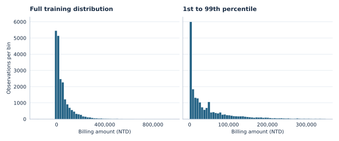
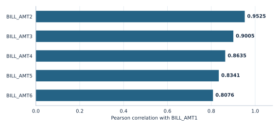
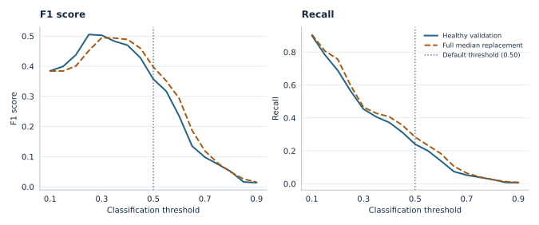
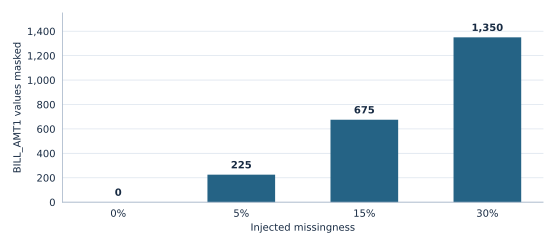
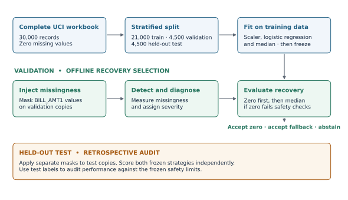
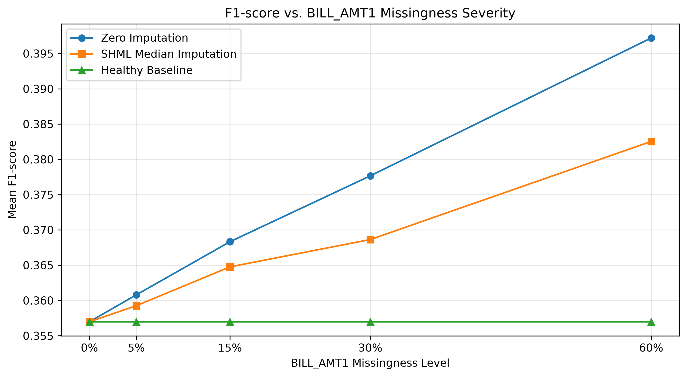
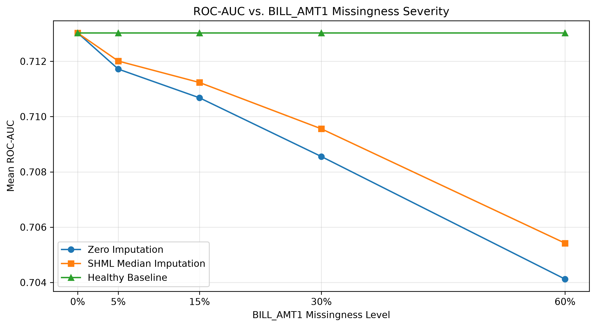
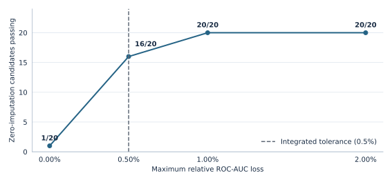
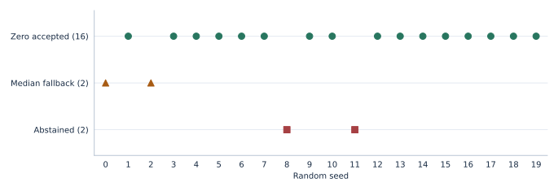
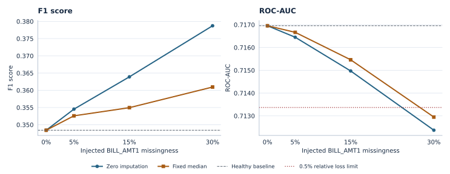

# A Self-Healing Machine Learning System for Automated Failure Detection and Model Recovery in Credit-Default Prediction

## Abstract

Machine learning systems can experience changes in predictive performance when incoming data contains missing or corrupted values. Detecting these failures, selecting corrective actions, and determining whether a recovery is safe are important challenges in maintaining reliable machine learning pipelines.

This study develops and evaluates a Self-Healing Machine Learning (SHML) framework for controlled missing-data failures in credit-default prediction. Using the UCI Default of Credit Card Clients dataset and a Logistic Regression classifier, the system integrates failure detection, diagnosis, recovery selection, performance evaluation, and safety validation.

The source workbook contains no missing values. The experiments deliberately mask BILL_AMT1 values in copies of the validation and held-out test features to evaluate the response to simulated missingness. Zero and training-median imputation are evaluated using F1-score, recall, and ROC-AUC. A multi-metric safety policy determines whether a candidate is accepted, replaced by a fallback, or rejected.

Across 20 validation corruption patterns at 15% missingness, the integrated policy accepted zero imputation in 16 cases, selected median fallback in two cases, and abstained in two cases. All 20 decisions matched previously recorded notebook results.

Held-out test results reveal a performance tradeoff: F1 increased under the evaluated imputation strategies while ROC-AUC decreased as missingness increased. At 30% missingness, both strategies violated the predefined ROC-AUC safety tolerance.

These findings demonstrate reproducible, validation-based recovery decisions and the importance of multi-metric safety evaluation. However, the experiments do not establish recovery from F1 degradation or autonomous deployment without ground-truth labels.

**Keywords:** Self-Healing Machine Learning, Missing Data, Credit-Default Prediction, Model Recovery, Safety Validation, Reproducibility, Logistic Regression

---

# 1. Introduction

## 1.1 Background

Machine learning models are increasingly used to support decisions in domains such as finance, healthcare, transportation, and business operations. Although these models are typically developed and evaluated using historical datasets, their predictive reliability can be affected by changes in the quality and characteristics of incoming data.

Missing values, corrupted features, and distribution changes may alter model predictions and reduce performance. Traditional machine learning pipelines often rely on manual monitoring, investigation, and corrective intervention when such problems occur.

Self-Healing Machine Learning (SHML) investigates how these activities can be organized into a systematic workflow that detects failures, diagnoses their potential causes, evaluates corrective actions, and determines whether a recovery is acceptable.

An important challenge is that improving one performance metric does not necessarily improve overall model reliability. A corrective action may improve classification F1-score while reducing the model's ability to distinguish between positive and negative classes, as measured by ROC-AUC.

This motivates recovery strategies that consider multiple performance criteria rather than relying on a single metric.

## 1.2 Problem Statement

The central problem addressed by this research is determining whether a machine learning system can respond to controlled data-quality failures while maintaining predefined predictive-performance requirements.

Specifically, this study investigates how SHML responds when BILL_AMT1 values are deliberately masked in experimental copies of complete credit-default data.

The research examines whether an integrated workflow can:

1. Identify when missingness exceeds a predefined threshold.
    
2. Diagnose the affected feature and failure severity.
    
3. Evaluate alternative missing-value correction strategies.
    
4. Accept recovery candidates that satisfy performance and integrity requirements.
    
5. Select a fallback or abstain when a preferred recovery is unacceptable.
    
6. Reproduce recovery decisions under controlled experimental conditions.
    

The study also investigates the limitations of interpreting recovery effectiveness using F1-score alone.

## 1.3 Research Objective

The primary objective is to develop and experimentally evaluate a reproducible SHML framework for controlled missingness in credit-default prediction.

The study emphasizes three areas:

- **Failure handling:** Detecting and diagnosing controlled missing-data conditions.
    
- **Recovery safety:** Comparing correction strategies and enforcing predefined performance constraints.
    
- **Reproducibility:** Verifying that repeated experiments produce consistent and independently reconstructable results.
    

The investigation is intentionally restricted to BILL_AMT1 to support a focused analysis of failure severity, recovery behavior, and metric-specific outcomes.

## 1.4 Research Question

The primary research question is:

**To what extent can a reproducible self-healing machine learning pipeline detect, diagnose, and respond to controlled missingness in BILL_AMT1 while maintaining acceptable predictive performance and enforcing recovery safety constraints?**

The study also examines how missingness severity, recovery strategy, and evaluation metric influence recovery decisions.

## 1.5 Research Contributions

This research makes four principal contributions.

**1. Integrated recovery workflow.** A modular SHML pipeline combines missingness detection, failure diagnosis, candidate recovery, predictive evaluation, and safety-based selection.

**2. Comparative recovery evaluation.** The study examines zero and training-median imputation under controlled missingness conditions, identifying differences between F1-score and ROC-AUC behavior.

**3. Multi-metric safety mechanism.** The recovery policy incorporates predefined F1, recall, and ROC-AUC constraints. It can accept a preferred candidate, select a fallback, or abstain when neither satisfies the required conditions.

**4. Reproducibility verification.** The integrated implementation reproduces all 20 recovery decisions obtained in the corresponding validation notebook experiments.

Together, these contributions provide evidence for a controlled, reproducible framework for evaluating recovery decisions and expose limitations that must be addressed before autonomous deployment.

## 1.6 Scope and Limitations

The main study uses one complete source dataset, one baseline classification algorithm, and one feature selected for simulated missingness.

Recovery selection is evaluated in an offline setting using labeled validation observations. The final test experiments assess the frozen correction strategies and perform retrospective safety audits.

The study does not demonstrate production-ready autonomous recovery, guaranteed restoration from performance degradation, or reliability across unrelated datasets and model architectures.

These boundaries are maintained to distinguish the capabilities demonstrated experimentally from broader SHML objectives that remain future research.

# 2. Literature Review

## 2.1 Self-Healing Machine Learning

Self-Healing Machine Learning (SHML) is an emerging research direction that investigates how machine learning systems can identify performance failures, diagnose their causes, and select appropriate corrective actions.

Rauba et al. (2024) [1] proposed a theoretical framework for self-healing machine learning that emphasizes diagnosis-driven adaptation. Their work distinguishes self-healing approaches from conventional methods that apply predefined adaptations without identifying the underlying causes of performance degradation.

The framework motivates an important research principle: selecting a corrective action should depend on an understanding of the failure rather than simply observing that predictive performance has changed.

The present study adapts this principle to a controlled missing-data experiment. Rather than implementing a general autonomous adaptation framework, the SHML system uses rule-based detection and diagnosis to evaluate missing-value correction strategies in a credit-default classification pipeline.

## 2.2 Reliability and Technical Debt in Machine Learning Systems

Sculley et al. (2015) [7] investigated hidden technical debt in machine learning systems. Their research identified challenges associated with data dependencies, system complexity, feedback loops, configuration management, and changes in external environments.

These challenges demonstrate that maintaining a machine learning system requires more than training a predictive model. Reliability also depends on data processing, monitoring, testing, and system-level controls.

For the present study, these findings motivate separating failure detection, diagnosis, recovery, evaluation, and safety validation into individual software components.

This modular architecture allows recovery behavior to be examined and tested independently while preserving a reproducible experimental workflow.

## 2.3 Testing and Validation of Machine Learning Systems

Breck et al. (2017) [8] proposed the ML Test Score, a framework for evaluating machine learning production readiness through systematic testing and monitoring.

Their work highlights the importance of testing data, models, and supporting infrastructure rather than relying exclusively on predictive accuracy.

This principle is relevant to SHML because a corrective action may preserve software functionality while still producing unacceptable predictive outcomes.

The present study therefore combines data-integrity verification with performance-based safety constraints.

Recovery candidates are evaluated using F1-score, recall, and ROC-AUC. A candidate that violates predefined requirements may be rejected, even when another metric improves.

The SHML implementation also incorporates automated tests and reproducibility checks to reduce the risk of undetected changes in recovery-policy behavior.

## 2.4 Detecting Changes in Data Distributions

Rabanser et al. (2019) [9] conducted an empirical investigation of methods for detecting dataset shift, emphasizing the importance of identifying changes in the statistical characteristics of incoming data.

Their research establishes a broader context for monitoring data distributions in machine learning applications.

The present study focuses on a narrower problem: controlled missingness in the BILL_AMT1 feature.

Missingness is introduced at predefined levels, allowing the experiment to measure whether the detector identifies the injected condition and how subsequent imputation affects predictive performance.

Unlike general-purpose dataset-shift detection, the implemented detector uses an explicit missingness threshold. This simplifies interpretation but limits the range of failures the system can identify.

## 2.5 Research Gap and Motivation

The reviewed literature establishes several relevant principles:

1. Recovery actions should be informed by failure diagnosis [1].
    
2. Machine learning reliability depends on system-level monitoring and maintenance [7].
    
3. Data and model testing are necessary components of trustworthy ML pipelines [8].
    
4. Changes in data characteristics must be monitored because they can affect predictive behavior [9].
    

This study combines these principles in a focused experiment examining whether missing-value correction strategies satisfy multiple performance requirements.

The central experimental concern is that an intervention judged beneficial using one metric may produce unfavorable outcomes under another.

Accordingly, this research investigates not only whether recovery strategies change model performance, but also whether an explicit safety policy can identify unacceptable candidates and select a fallback or abstain.

The contribution is a controlled, reproducible evaluation of these decisions for BILL_AMT1 missingness, rather than a claim of general-purpose autonomous self-healing.

## 2.6 Summary

Existing research provides the conceptual foundation for SHML through diagnosis-driven adaptation, ML system reliability, systematic validation, and monitoring of changes in data characteristics.

Building on these ideas, the present study implements a modular experimental pipeline for detecting BILL_AMT1 missingness, comparing recovery strategies, and evaluating candidates against predefined safety criteria.

The next section presents the research questions and hypotheses used to assess the effectiveness, limitations, and reproducibility of this implementation.

# 3. Research Questions and Hypotheses

## 3.1 Primary Research Question

The primary research question proposed for this study is:

**To what extent can a reproducible self-healing machine learning pipeline accurately detect, diagnose, and recover a credit-default classification system from controlled data-quality and distribution failures while maintaining acceptable predictive performance across relevant population subgroups?**

The completed experimental implementation focuses specifically on controlled missingness in the BILL_AMT1 feature.

This narrower scope allows detailed investigation of the relationship between missingness severity, corrective actions, predictive performance, and recovery safety.

## 3.2 Secondary Research Questions

The study is guided by seven secondary research questions:

**RQ1 — Failure Detection**

How reliably can the SHML system detect meaningful degradation in the credit-default classification pipeline?

**RQ2 — Failure Diagnosis**

How accurately can statistical diagnostics identify controlled failures, including missing values, class imbalance, label noise, outliers, feature corruption, and covariate shift?

**RQ3 — Recovery Effectiveness**

Does diagnosis-guided correction recover more lost predictive performance than no intervention or generic retraining without failure-specific correction?

**RQ4 — Recovery Safety**

Can an independent validation and rollback mechanism prevent ineffective or harmful model updates from replacing the approved model?

**RQ5 — Failure Severity**

How does failure severity affect degradation detection, diagnostic accuracy, and successful recovery?

**RQ6 — Reproducibility**

To what extent can the experimental pipeline reproduce equivalent results across repeated local executions and a selected cloud environment?

**RQ7 — Subgroup Reliability**

Do controlled failures and corrective interventions affect predictive performance differently across demographic or other relevant data subgroups?

An additional exploratory research question concerns whether LLMs supported by structured statistical evidence and retrieval-augmented generation can improve failure diagnosis and corrective-action selection.

This exploratory component is excluded from the completed core experiments.

## 3.3 Research Hypotheses

The original proposal defines six primary hypotheses and one exploratory hypothesis.

### H1 — Model Degradation

Controlled data-quality and distribution failures will produce measurable degradation in the credit-default classifier.

Degradation will be measured primarily through changes in F1-score and ROC-AUC relative to a healthy baseline, supplemented by precision, recall, and subgroup-level metrics.

### H2 — Diagnosis-Guided Recovery

Corrective actions selected according to the diagnosed failure type will recover more lost predictive performance than no intervention or generic retraining without failure-specific correction.

Recovery effectiveness will be evaluated through post-intervention predictive performance and the percentage of lost performance recovered.

### H3 — Validation and Rollback

A predefined validation gate will reduce the frequency of harmful or ineffective repairs being accepted into the approved model pipeline.

The effectiveness of this mechanism will be evaluated through harmful-update acceptance, false rejection, and rollback correctness.

### H4 — Failure Severity

Increasing failure severity will generally produce larger performance degradation and may improve detectability while reducing the likelihood of successful recovery.

The relationship between severity and recovery performance will be investigated across multiple controlled failure levels.

### H5 — Reproducibility

The SHML pipeline will produce reproducible experimental outcomes when datasets, random seeds, preprocessing procedures, model configurations, dependencies, and evaluation protocols are consistently controlled and documented.

Reproducibility will be assessed through repeated execution, agreement between recorded metrics, consistency of recovery decisions, and reconstruction of experimental results.

### H6 — Subgroup Performance and Reliability

Controlled failures and corrective interventions may produce unequal performance changes across demographic or other relevant subgroups.

The study will investigate whether aggregate recovery results conceal disproportionate degradation within individual populations.

### H7 — Exploratory LLM/RAG Hypothesis

An LLM supplied with structured diagnostic evidence and retrieved technical knowledge will identify controlled failure types and recommend appropriate corrective actions more accurately than an LLM operating without retrieval.

This hypothesis is optional and was not investigated in the completed core experiments.

## 3.4 Operational Scope of the Completed Experiments

Although the original research questions address several categories of data and model failures, the completed experiments focus on controlled missingness in BILL_AMT1.

The evaluated system uses:

- The UCI Default of Credit Card Clients dataset.
    
- A Logistic Regression baseline classifier.
    
- Controlled missingness injection.
    
- Rule-based missingness detection and diagnosis.
    
- Zero and training-median imputation in the integrated recovery policy.
    
- F1-score, recall, and ROC-AUC safety constraints.
    
- Repeated-seed validation and reproducibility testing.
    
- A final held-out test evaluation.
    

This restricted experimental design does not provide evidence for all originally proposed hypotheses.

In particular, the completed study does not establish diagnosis-guided recovery across multiple failure categories, subgroup-level reliability, or successful cross-environment reproduction.

These limitations are considered when interpreting the findings in the Discussion section.

## 3.5 Hypothesis Evaluation Approach

The hypotheses are evaluated according to the available experimental evidence.

Each hypothesis will be classified as:

- **Supported within the tested scope:** The experiments provide evidence consistent with the hypothesis for the evaluated configuration.
    
- **Partially supported:** Some predicted outcomes are observed, but the full hypothesis is not demonstrated.
    
- **Not established:** The experiments do not provide sufficient evidence to confirm the hypothesis.
    
- **Not tested:** The relevant experiments were not conducted.
    

The final assessment will distinguish scientific findings from implemented functionality.

For example, successfully implementing an automated recovery-selection function does not by itself establish that the system restores degraded predictive performance.

Similarly, matching recovery decisions across repeated experiments supports computational reproducibility but does not establish independent generalization across different datasets.

This evaluation framework is intended to ensure that the study's conclusions remain consistent with the empirical evidence.

# 4. Research Methodology

## 4.1 Dataset Description

### 4.1.1 Dataset Overview

This research uses the **Default of Credit Card Clients** dataset from the UCI Machine Learning Repository.

The dataset contains financial, demographic, and payment-history information for 30,000 credit-card clients in Taiwan. It is commonly used for evaluating binary classification approaches to credit-default prediction.

The prediction task is to determine whether a client will default on a credit-card payment in the following month.

The dependent variable is represented as:

- **0:** No default payment in the following month.
    
- **1:** Default payment in the following month.
    

The original dataset contains 23 predictive variables, a client identification field, and the binary target variable. The identification field is excluded from model training because it serves as a record identifier rather than a predictive attribute.

### 4.1.2 Dataset Characteristics

|Characteristic|Description|
|---|---|
|Dataset|Default of Credit Card Clients|
|Source|UCI Machine Learning Repository|
|Observations|30,000|
|Predictor variables|23|
|Target variable|Default payment next month|
|Prediction problem|Binary classification|
|Primary experimental feature|BILL_AMT1|
|Baseline algorithm|Logistic Regression|

The predictor variables describe multiple aspects of clients' financial behavior, including credit limits, repayment status, historical billing amounts, previous payments, and demographic attributes.

### 4.1.3 Target Variable Distribution

The dataset exhibits an imbalanced target distribution, with approximately 22.12% of observations belonging to the default class and 77.88% belonging to the non-default class.

Because the majority of clients do not default, classification accuracy alone may provide an incomplete assessment of model performance.

For this reason, the study emphasizes F1-score and recall, supplemented by precision, accuracy, and ROC-AUC.

F1-score provides a combined measure of precision and recall, while ROC-AUC evaluates the model's ability to rank positive observations above negative observations across classification thresholds.

### 4.1.4 Experimental Feature: BILL_AMT1

The primary feature investigated in this study is **BILL_AMT1**, which represents the amount of a client's bill statement in September 2005.

This variable was selected to support a focused investigation of controlled numerical missingness and its effects on credit-default prediction.

The research examines how removing different proportions of observed BILL_AMT1 values influences model performance and how alternative imputation strategies affect the resulting predictions.

The training distribution exhibits the following characteristics:

|Statistic|BILL_AMT1|
|---|---|
|Mean|51,194.22|
|Standard deviation|73,633.98|
|Median|22,225.50|
|Minimum|−165,580|
|Maximum|964,511|
|Skewness|2.6656|
|Negative observations|412|
|Zero observations|1,399|

These statistics indicate a strongly right-skewed distribution with substantial variation in billing amounts.

The difference between the mean and median indicates that large positive values influence the distribution.

The training median of 22,225.50 is used as the fixed replacement value for the median-imputation recovery strategy.

### 4.1.5 Relationships With Other Billing Variables

BILL_AMT1 is strongly correlated with other billing amount variables.

The training-data correlations include:

|Feature|Correlation with BILL_AMT1|
|---|---|
|BILL_AMT2|0.9525|
|BILL_AMT3|0.9005|
|BILL_AMT4|0.8635|
|BILL_AMT5|0.8341|
|BILL_AMT6|0.8076|

These strong relationships suggest that information contained in BILL_AMT1 may overlap with information available in other billing variables.

This possibility provides an important motivation for investigating why artificially introduced BILL_AMT1 missingness does not necessarily cause substantial F1-score deterioration.

However, correlation alone does not establish that feature redundancy is responsible for the observed model behavior.

### 4.1.6 Rationale for Focusing on One Feature

Although the dataset contains 23 predictors, the completed core experiments focus on BILL_AMT1.

Restricting the experimental scope to one numerical feature allows missingness severity and imputation effects to be evaluated without simultaneously changing multiple feature distributions.

This approach also enables detailed investigation of the feature's statistical characteristics, predictive influence, and relationships with other variables.

The results provide a focused assessment of recovery behavior under BILL_AMT1 missingness. They are not assumed to generalize automatically to missingness in other predictors or to unrelated data-quality failures.

## 4.2 Data Preprocessing and Dataset Partitioning

### 4.2.1 Data Preparation

The UCI Default of Credit Card Clients dataset was loaded using Python and pandas. The original dataset contains 30,000 observations, 23 predictor variables, an identification column, and a binary target variable.

The `ID` column was excluded from the predictive features, and `default payment next month` was designated as the target variable.

The remaining 23 variables were retained for baseline model development.

The data audit found zero missing entries in the source workbook, including all 23 predictors. The experiments deliberately introduced missing values into copies of the relevant feature matrices while preserving the source workbook and the original partitions.

### 4.2.2 Stratified Dataset Partitioning

To support model training, recovery-policy evaluation, and independent final testing, the dataset was divided into three mutually exclusive partitions.

|Partition|Observations|Percentage|Purpose|
|---|---|---|---|
|Training|21,000|70%|Model fitting and preprocessing statistics|
|Validation|4,500|15%|Recovery comparisons, safety-policy evaluation, and repeated-seed experiments|
|Testing|4,500|15%|Final held-out evaluation|
|**Total**|**30,000**|**100%**||

Stratified random sampling was used to preserve approximately the same target-class proportions across partitions.

The splitting procedure was performed in two stages:

1. The dataset was separated into 70% training data and 30% temporary data.
    
2. The temporary data was divided equally into validation and test partitions.
    

Both stages used a fixed random state of 42.

This approach establishes distinct partitions for model development, validation-based experimental decisions, and final evaluation.

### 4.2.3 Class Distribution

The target distribution was approximately consistent across the three dataset partitions.

|Partition|Non-default (Class 0)|Default (Class 1)|
|---|---|---|
|Training|77.88%|22.12%|
|Validation|77.89%|22.11%|
|Testing|77.87%|22.13%|

The class imbalance is relevant because a model can achieve relatively high classification accuracy by favoring the majority class.

Consequently, F1-score and recall were emphasized when evaluating the classifier, with ROC-AUC used to assess ranking performance.

### 4.2.4 Feature Standardization

The baseline Logistic Regression model was trained using standardized numerical predictors.

Feature standardization was implemented using `StandardScaler` from scikit-learn.

For each feature, standardization transforms an observed value according to:

$$
z = \frac{x-\mu_{\mathrm{train}}}{\sigma_{\mathrm{train}}}
$$

where:

- $x$ represents the original feature value.
    
- $\mu_{\mathrm{train}}$ is the mean calculated from the training partition.
    
- $\sigma_{\mathrm{train}}$ is the standard deviation calculated from the training partition.
    

The scaler was fitted exclusively on the training partition and then applied to validation and test observations.

This procedure ensures that the validation and test partitions do not influence the preprocessing parameters used by the trained classifier.

### 4.2.5 Prevention of Data Leakage

Data leakage occurs when information unavailable during model development is used to train or configure a predictive system.

Several precautions were incorporated into the SHML experimental design.

First, the train, validation, and test partitions were established before model fitting.

Second, the StandardScaler was fitted using training observations only.

Third, the median replacement value for BILL_AMT1 was calculated from the training partition rather than separately from validation or test observations.

Fourth, the recovery-policy experiments were conducted using validation observations.

The final test partition was reserved until the model configuration and experimental recovery criteria had been selected.

The final test evaluation was conducted once using the frozen configuration. Test results were not used to modify model parameters, imputation strategies, or recovery-safety tolerances.

The implemented safety controller evaluates predictive metrics using known labels. Accordingly, its validation decisions represent an offline research procedure rather than an unlabeled production-time mechanism.

### 4.2.6 Reproducibility Controls

Reproducibility was supported through fixed experimental configurations and documented random seeds.

The primary controls included:

- Fixed dataset and predictor definitions.
    
- Stratified splitting using `random_state=42`.
    
- Logistic Regression using `random_state=42`.
    
- StandardScaler fitted only on training data.
    
- Training-derived BILL_AMT1 median.
    
- Deterministic missingness injection for a specified seed.
    
- Consistent evaluation metrics and safety criteria.
    
- Saved experiment results and regression tests.
    

The integrated robustness experiment evaluated 20 missingness patterns using seeds 0 through 19.

All 20 recovery-policy decisions matched the corresponding research notebook results.

This provides evidence of reproducibility under the evaluated local experimental conditions. It does not establish equivalence across all operating systems, dependency versions, or independently sampled datasets.

### 4.2.7 Data Integrity and Experimental Isolation

Artificial missingness was introduced only into copies of the experimental data.

The injection procedure preserved the original observation indices, predictor columns, and feature values outside the targeted BILL_AMT1 entries.

Recovery candidates were also checked to confirm that missing entries were replaced as intended without modifying unrelated features.

These checks help distinguish changes caused by the intended intervention from accidental data manipulation.

The train/validation/test separation, training-derived preprocessing parameters, and data-integrity checks together provide a controlled foundation for evaluating the subsequent SHML recovery experiments.

## 4.3 Baseline Model Development and Evaluation

### 4.3.1 Baseline Model Selection

Logistic Regression was selected as the baseline classification algorithm for the SHML experiments.

Logistic Regression is a supervised learning algorithm commonly used for binary classification tasks. It estimates the probability that an observation belongs to the positive class based on a weighted combination of input features.

The model was selected because it provides a computationally efficient and relatively interpretable starting point for investigating the effects of controlled data-quality failures.

Using a fixed baseline classifier also allows the study to focus on recovery behavior without introducing changes caused by multiple model architectures.

### 4.3.2 Mathematical Formulation

For a binary classification problem, Logistic Regression estimates the probability of the positive class using the logistic function:

$$
P(Y=1\mid X)=\frac{1}{1+e^{-z}}
$$

where:

$$
z=\beta_0+\sum_{j=1}^{p}\beta_jx_j
$$

Here:

- $P(Y=1\mid X)$ represents the estimated probability of default.
    
- $\beta_0$ represents the intercept.
    
- $\beta_j$ represents the coefficient associated with predictor $x_j$.
    
- $p=23$ represents the number of predictors.
    

The baseline classifier converts predicted probabilities into binary classifications using the default decision threshold of 0.50.

Observations with estimated default probabilities at or above 0.50 are classified as default cases, while observations below the threshold are classified as non-default cases.

### 4.3.3 Model Training Configuration

The baseline classifier was implemented using `LogisticRegression` from scikit-learn.

|Parameter|Configuration|
|---|---|
|Algorithm|Logistic Regression|
|Number of predictors|23|
|Training observations|21,000|
|Feature transformation|StandardScaler|
|Maximum iterations|1,000|
|Random state|42|
|Classification threshold|0.50|

The StandardScaler was fitted exclusively on the training data.

The transformed training observations were then used to fit the Logistic Regression classifier.

The fitted scaler and trained classifier were retained for all subsequent missingness and recovery experiments.

Neither the scaler nor the classification model was retrained separately for each recovery candidate.

This design isolates the effects of missingness and imputation from changes in model training.

### 4.3.4 Healthy Baseline Performance

The baseline model was evaluated on the validation partition before introducing any artificial missingness.

The resulting metrics established the healthy reference against which subsequent recovery candidates were compared.

|Evaluation Metric|Healthy Validation Score|
|---|---|
|Accuracy|0.808667|
|Precision|0.694767|
|Recall|0.240201|
|F1-score|0.356983|
|ROC-AUC|0.713025|

Although the model achieved approximately 80.87% accuracy, recall was substantially lower at approximately 24.02%.

This indicates that the classifier identified only a relatively small proportion of actual default cases at the selected classification threshold.

Consequently, accuracy alone was not considered sufficient for evaluating recovery effectiveness.

### 4.3.5 Selection of Evaluation Metrics

Five evaluation metrics were used throughout the experiments.

**Accuracy**

Accuracy measures the proportion of correctly classified observations:

$$
Accuracy=\frac{TP+TN}{TP+TN+FP+FN}
$$

**Precision**

Precision measures the proportion of predicted default cases that actually belong to the default class:

$$
Precision=\frac{TP}{TP+FP}
$$

**Recall**

Recall measures the proportion of actual default cases correctly identified:

$$
Recall=\frac{TP}{TP+FN}
$$

**F1-Score**

F1-score is the harmonic mean of precision and recall:

$$
F1=2\left(\frac{Precision\times Recall}{Precision+Recall}\right)
$$

F1-score was selected as the primary classification metric because the dataset contains an imbalanced target distribution and both false-positive and false-negative predictions are relevant to performance assessment.

**ROC-AUC**

ROC-AUC measures the classifier's ability to rank positive observations above negative observations across classification thresholds.

Unlike F1-score, which depends on a selected classification threshold, ROC-AUC evaluates ranking behavior across multiple thresholds.

This distinction is particularly important for the SHML experiments because imputation strategies may improve F1 at the fixed 0.50 threshold while simultaneously reducing ROC-AUC.

### 4.3.6 Baseline Performance Interpretation

The healthy model's F1-score of 0.356983 and ROC-AUC of 0.713025 provide two complementary reference measurements.

F1-score evaluates the quality of binary classifications at the chosen threshold, while ROC-AUC evaluates the model's overall ranking ability.

The baseline model demonstrates moderate ranking performance but relatively low recall.

These findings support the use of multiple evaluation criteria when assessing whether a corrective intervention should be accepted.

A candidate with higher F1-score should not automatically be treated as safe if its recall, ROC-AUC, or data integrity violates predefined requirements.

### 4.3.7 Role of the Baseline in SHML

The healthy baseline performs three functions within the SHML framework.

First, it establishes the reference model performance before controlled failure injection.

Second, it provides the benchmark for measuring changes in predictive metrics following imputation.

Third, it supplies reference metrics for the safety controller, which compares recovery candidates against predefined relative-loss tolerances.

The baseline therefore serves as both a predictive model and an experimental reference for evaluating the effects of missing-data interventions.

The next subsection examines the statistical characteristics of BILL_AMT1 and its relationship with the classifier's predictions.

## 4.4 Statistical and Predictive Investigation of BILL_AMT1

### 4.4.1 Purpose of the Investigation

A detailed investigation of BILL_AMT1 was conducted to understand its statistical characteristics, relationships with other predictors, and contribution to the Logistic Regression model.

The investigation was motivated by an important observation from the initial SHML experiments: artificially introduced missingness in BILL_AMT1 did not consistently reduce F1-score.

The analysis therefore examined four questions:

1. What are the statistical characteristics of BILL_AMT1?
    
2. How strongly is BILL_AMT1 associated with other billing variables?
    
3. How sensitive are the model's predictions to changes in BILL_AMT1?
    
4. Can relationships among predictors help explain the model's apparent resilience to BILL_AMT1 missingness?
    

The analysis used the original training and validation partitions and retained the previously trained baseline classifier.

### 4.4.2 Distributional Characteristics

The training partition contained 21,000 observations.

Descriptive statistics for BILL_AMT1 are presented below.

|Statistic|Value|
|---|---|
|Mean|51,194.22|
|Median|22,225.50|
|Standard deviation|73,633.98|
|Minimum|−165,580|
|First quartile|3,509.75|
|Third quartile|67,062.75|
|Maximum|964,511|
|Skewness|2.6656|
|Negative observations|412|
|Zero observations|1,399|

The training distribution is strongly right-skewed, with a skewness coefficient of 2.6656.

The mean is substantially greater than the median, indicating the influence of large positive billing amounts.

Negative values account for approximately 1.96% of training observations, while zero values account for approximately 6.66%.

Negative billing amounts were not automatically classified as data errors because they may represent financial adjustments or credits.

These characteristics motivated comparisons among different imputation methods. However, the distributional analysis alone does not establish which strategy provides the best predictive performance.

**Figure 2. Distribution of `BILL_AMT1`.** Each panel uses 60 bins. The full panel represents all 21,000 training observations. The second shows the values between the 1st and 99th percentiles.

[Interactive distribution in the audit notebook](../research/bill_amt1/01_audit.ipynb)

### 4.4.3 Correlation With Other Billing Variables

Pearson correlations were calculated using the training partition to investigate relationships between BILL_AMT1 and other billing amount predictors.

|Predictor|Correlation with BILL_AMT1|
|---|---|
|BILL_AMT2|0.9525|
|BILL_AMT3|0.9005|
|BILL_AMT4|0.8635|
|BILL_AMT5|0.8341|
|BILL_AMT6|0.8076|

BILL_AMT1 exhibits strong positive correlations with the other billing amount variables.

The strongest relationship is with BILL_AMT2, with a Pearson correlation coefficient of 0.9525.

These relationships suggest that substantial information is shared among consecutive billing variables.

Such overlap may contribute to the model's relative stability when BILL_AMT1 is modified.

However, correlation does not demonstrate that one predictor can fully replace another or establish that feature redundancy is responsible for the observed predictive behavior.

**Figure 7. Correlations Between `BILL_AMT1` and Other Billing Variables.** Pearson correlations use the unmodified training partition.

[Interactive correlation matrix in the audit notebook](../research/bill_amt1/01_audit.ipynb)

### 4.4.4 Logistic Regression Coefficient Analysis

The coefficients of the trained Logistic Regression model were examined to investigate the conditional relationship between each standardized predictor and the estimated probability of default.

BILL_AMT1 had a coefficient of −0.312812 and ranked second among the 23 predictors by absolute coefficient magnitude.

|Predictor|Coefficient|Absolute-magnitude rank|
|---|---|---|
|PAY_0|0.653654|1|
|BILL_AMT1|−0.312812|2|
|PAY_AMT2|−0.253532|3|
|PAY_AMT1|−0.152160|4|
|LIMIT_BAL|−0.116704|5|

The negative BILL_AMT1 coefficient indicates a negative conditional association with predicted default log-odds when other predictors are held constant.

However, the strong correlations among billing variables introduce multicollinearity.

Therefore, coefficient magnitude alone cannot establish predictive importance or determine the effects of removing BILL_AMT1 information.

A controlled prediction-sensitivity experiment was conducted to investigate these effects directly.

### 4.4.5 Controlled Prediction-Sensitivity Experiment

To measure the influence of BILL_AMT1 on model outputs, all BILL_AMT1 values in the validation partition were replaced with the training median of 22,225.50.

This intervention modified BILL_AMT1 while preserving the other predictor values.

The trained Logistic Regression model and training-fitted scaler remained unchanged.

Predictions from the modified observations were compared with predictions from the original healthy validation data.

The experiment produced the following results:

|Measurement|Result|
|---|---|
|Validation observations|4,500|
|Changed binary predictions|94|
|Prediction change rate|2.09%|
|Mean absolute probability change|0.029674|

Only 94 of the 4,500 binary classification decisions changed after complete median replacement.

However, predicted probabilities changed, indicating that BILL_AMT1 contributes to the classifier's calculations even when the final predicted class remains unchanged.

### 4.4.6 Predictive Performance Under Complete Median Replacement

The performance comparison is summarized below.

|Metric|Healthy|Median-replaced BILL_AMT1|
|---|---|---|
|Accuracy|0.808667|0.810000|
|Precision|0.694767|0.665094|
|Recall|0.240201|0.283417|
|F1-score|0.356983|0.397463|
|ROC-AUC|0.713025|0.701094|

Replacing all BILL_AMT1 values with the training median increased F1-score and recall at the fixed classification threshold of 0.50.

However, precision and ROC-AUC declined.

The F1-score increased by approximately 0.0405 in absolute terms, while ROC-AUC decreased by approximately 0.0119.

This demonstrates that feature modification can affect classification performance differently depending on the selected evaluation metric.

Importantly, the experiment does not establish successful recovery. It evaluates the model's sensitivity to a controlled feature modification rather than restoration from an independently measured degraded condition.

### 4.4.7 Classification-Threshold Sensitivity

The research also examined classification thresholds between 0.10 and 0.90.

This analysis compared F1-score and recall for healthy observations and observations with BILL_AMT1 replaced by the training median.

The results showed that the relationship between healthy and modified F1-scores varied across classification thresholds.

For example, at a threshold of 0.10, healthy F1 was approximately 0.3846, compared with 0.3842 under the modified feature condition.

This contrasts with the larger F1 improvement observed at the original threshold of 0.50.

These findings indicate that some observed F1 improvements depend on where the classifier's probability estimates fall relative to the selected decision threshold.

ROC-AUC provides a complementary assessment because it evaluates ranking performance across classification thresholds.

**Figure 8. Model Performance Across Classification Thresholds.** Both conditions use the same frozen classifier and validation labels. The intervention replaces every BILL_AMT1 value with the training median. The dotted line marks the default threshold of 0.50.

[Interactive F1 plot in the audit notebook](../research/bill_amt1/01_audit.ipynb)

### 4.4.8 Interpretation and Implications

The investigation produced three important findings.

First, BILL_AMT1 is strongly associated with other billing amount predictors, suggesting that its information may partially overlap with information contained elsewhere in the feature set.

Second, modifying BILL_AMT1 changes predicted probabilities without necessarily changing many binary classification decisions.

Third, improvements in F1-score do not necessarily correspond to improvements in ROC-AUC.

Together, these findings help explain why BILL_AMT1 missingness did not consistently produce the expected F1 deterioration.

However, the evidence does not establish that feature redundancy is the primary cause of model resilience.

Further feature-ablation or conditional-importance experiments would be necessary to test that explanation more directly.

For the completed SHML study, these results motivate the use of multiple evaluation metrics and predefined safety constraints when assessing recovery candidates.

## 4.5 Controlled Missingness Injection and Experimental Design

### 4.5.1 Purpose of Failure Injection

The SHML framework was evaluated using controlled missing-data experiments to investigate the effects of data-quality failures on credit-default prediction.

The UCI Default of Credit Card Clients workbook used here contains no missing values. The experiments simulate incomplete observations by masking selected BILL_AMT1 values in copies of the validation features. The final held-out evaluation separately masks copies of the test features.

Controlled failure injection allows the experiment to specify the affected feature, missingness proportion, and random seed while preserving the remaining predictor values.

This approach enables comparisons between healthy observations and observations modified through predefined missingness interventions.

### 4.5.2 Failure Type

The primary failure investigated was numerical feature missingness.

The affected predictor was BILL_AMT1, representing the September 2005 bill statement amount.

Missing observations were generated by randomly selecting row positions and replacing their BILL_AMT1 values with NaN.

For a dataset containing $N$ observations and a target missingness proportion $m$, the number of injected missing values was calculated as:

$$
n_{\mathrm{missing}}=\lfloor N\times m\rfloor
$$

The selected observations were sampled without replacement.

The missingness mechanism was Missing Completely at Random (MCAR) by construction, because selection depended on a pseudorandom generator rather than observed feature values or the target variable.

This mechanism does not necessarily represent missingness patterns encountered in real financial datasets.

### 4.5.3 Missingness Severity Levels

The integrated offline recovery pipeline examined four missingness levels.

|Scenario|Missingness|Missing validation observations|
|---|---|---|
|Healthy reference|0%|0|
|Low missingness|5%|225|
|Moderate missingness|15%|675|
|High missingness|30%|1,350|

All scenarios used the 4,500-observation validation partition.

These levels were selected to examine recovery behavior as the proportion of unavailable BILL_AMT1 information increased.

An additional exploratory analysis examined 60% missingness. This higher-severity condition formed part of the expanded feature investigation and harmful-recovery experiments, but it was not included in the four-level final held-out evaluation.

**Figure 3. Controlled Missingness Injection at 0%, 5%, 15%, and 30%.** Counts show deliberately masked BILL_AMT1 values in copies of 4,500 validation observations using seed 42. The 0% batch is the complete reference.

### 4.5.4 Missingness Injection Procedure

Missingness was introduced after dataset partitioning and baseline model training.

For each experimental scenario, the injection procedure:

1. Created a deep copy of the experimental feature matrix.
    
2. Calculated the required number of missing observations.
    
3. Initialized a pseudorandom generator with the specified seed.
    
4. Selected row positions without replacement.
    
5. Replaced BILL_AMT1 values at those positions with NaN.
    
6. Returned the modified dataset without changing the original observations.
    

Only BILL_AMT1 was modified.

The remaining predictor columns, observation indices, and target labels were preserved.

The experimental model and training-fitted scaler also remained unchanged.

### 4.5.5 Random Seed Control

Random seed control was used to make the missingness experiments reproducible.

The original standalone pipeline used seed 42 for its primary missingness scenarios.

The integrated robustness experiment extended the injection function to accept an explicit random seed while retaining 42 as the default value.

This allowed the same experimental setup to generate different but reproducible missingness patterns.

At 15% missingness, the robustness experiment used 20 seeds, numbered 0 through 19.

Each seed selected 675 validation observations for corruption.

The fixed validation partition and trained model were retained across all 20 experiments.

Therefore, variability across the experiments reflects differences in the selected missingness masks rather than independent training datasets or separately trained classifiers.

### 4.5.6 Consistent Recovery Comparisons

The study compared multiple correction strategies under controlled missingness conditions.

The integrated recovery policy evaluated two strategies:

- Zero imputation, which replaces missing BILL_AMT1 values with zero.
    
- Training-median imputation, which replaces missing values with the median calculated from the training partition.
    

The preferred strategy was zero imputation, while training-median imputation served as the fallback.

The broader exploratory research also examined regression-based reconstruction of BILL_AMT1 using BILL_AMT2.

Comparing recovery methods under the same corruption pattern helps isolate differences attributable to the replacement strategy.

The integrated 20-seed experiment evaluated candidate repairs using predefined F1, recall, and ROC-AUC safety constraints.

### 4.5.7 Experimental Reproducibility

The experiment controlled the following components:

- Dataset partitioning and observation counts.
    
- Baseline classifier and training configuration.
    
- Training-fitted feature standardization.
    
- Target feature and missingness proportion.
    
- Random injection seed.
    
- Recovery strategies.
    
- Performance metrics.
    
- Safety decision thresholds.
    

The integrated robustness experiment successfully reproduced all 20 recovery decisions recorded in the corresponding research notebook.

The results included 16 preferred-strategy acceptances, two fallback acceptances, and two abstentions.

This agreement provides evidence of reproducible recovery-policy decisions under the tested configuration.

### 4.5.8 Experimental Boundaries

The controlled missingness design has several limitations.

First, random missingness does not capture missingness mechanisms that depend on client characteristics or unobserved financial circumstances.

Second, the experiments modify only one predictor and therefore do not investigate simultaneous corruption across multiple variables.

Third, repeated random seeds generate different corruption masks over the same validation observations. These repetitions do not constitute independent population samples.

Fourth, imputed candidate performance is evaluated using known labels. As a result, the recovery-selection workflow represents offline experimental validation rather than autonomous deployment without ground-truth labels.

Finally, the missingness experiments did not consistently produce F1-score deterioration. Accordingly, the results support analysis of recovery-strategy performance and metric-based safety decisions rather than a demonstration of restored F1 performance after degradation.

## 4.6 Automated Failure Detection and Diagnosis

### 4.6.1 Overview

The SHML framework implements rule-based failure detection and diagnosis to identify controlled missing-data conditions in the BILL_AMT1 predictor.

The detection component measures the proportion of missing values in incoming experimental data and compares it with the missingness observed in the healthy reference.

The diagnosis component interprets the detection result and assigns a failure type, severity classification, and recommended corrective action.

These components provide structured information to the subsequent recovery-selection workflow.

### 4.6.2 Missingness Detection

The missingness detector is implemented in `src/detection.py`.

For a feature containing $N$ observations, the current missingness rate is calculated as:

$$
M_{\mathrm{current}} =
\frac{N_{\mathrm{missing}}}{N}
$$

The increase in missingness relative to the healthy reference is then calculated as:

$$
\Delta M =
M_{\mathrm{current}} - M_{\mathrm{reference}}
$$

The healthy reference contains no missing BILL_AMT1 values; therefore:

$$
M_{\mathrm{reference}} = 0
$$

A failure is detected when the missingness increase is strictly greater than the predefined threshold:

$$
\text{Failure Detected} =
\begin{cases}
1 & \text{if } \Delta M > 0.05\\
0 & \text{otherwise}
\end{cases}
$$

The 5% threshold is an experimental configuration used to distinguish missingness conditions that warrant an alert. It was not established through an independently optimized statistical decision procedure.

### 4.6.3 Detection Results

The detector was evaluated using the predefined missingness scenarios.

|Injected missingness|Missing validation values|Failure detected|
|---|---|---|
|0%|0|No|
|5%|225|No|
|15%|675|Yes|
|30%|1,350|Yes|

The detector correctly follows its configured threshold rule.

At exactly 5% missingness, no alert is generated because the detection condition uses a strict greater-than comparison rather than greater-than-or-equal-to.

Consequently, the 5% scenario is treated as below the alert boundary despite containing missing observations.

These results establish correct execution of the configured rule for the evaluated scenarios. They do not establish detection accuracy for unknown failure types or naturally occurring data-quality problems.

### 4.6.4 Failure Diagnosis

The diagnosis component is implemented in `src/diagnosis.py`.

It receives the detector output and identifies:

- The affected feature.
    
- The current missingness rate.
    
- Whether the detection threshold was exceeded.
    
- The failure type.
    
- The assigned severity.
    
- A configured recovery recommendation.
    
- A human-readable diagnostic explanation.
    

The implemented diagnosis rules are specific to BILL_AMT1 missingness.

Other types of corruption, including categorical shifts, label noise, and distribution drift, are outside the scope of this diagnosis module.

### 4.6.5 Severity Classification

The diagnosis component classifies missingness according to predefined conditions.

|Condition|Severity|Configured recommendation|
|---|---|---|
|Missingness = 0%|None|No correction|
|Missingness at or below 5%, but above 0%|Below alert threshold|Routine median preprocessing|
|Missingness above 5% and at or below 20%|Moderate|Median imputation|
|Missingness above 20%|Severe|Median imputation|

Under these rules, the 15% scenario is categorized as moderate missingness and the 30% scenario as severe missingness.

These severity categories are operational definitions for the experimental system, not independently validated measures of real-world financial data risk.

### 4.6.6 Relationship Between Diagnosis and Recovery Selection

The diagnosis component generates a preliminary corrective-action recommendation.

However, the final integrated recovery policy evaluates zero imputation as its preferred candidate and training-median imputation as its fallback.

Therefore, the final correction is not selected solely from the diagnosis module's recommended action.

Instead, the diagnosis provides structured information while the recovery-selection function determines which candidate satisfies the predefined performance and integrity requirements.

This distinction is important when evaluating the diagnosis-guided recovery hypothesis.

The current implementation demonstrates integration of rule-based diagnosis with recovery evaluation. It does not establish that diagnosis-guided selection is superior to a generic recovery policy.

### 4.6.7 Implementation Verification

The detection and diagnosis functions were evaluated through controlled experimental scenarios and automated tests.

The results demonstrated that:

1. Healthy observations were not classified as missingness failures.
    
2. The 5% scenario remained below the strict alert threshold.
    
3. Missingness above the threshold generated an alert.
    
4. The diagnosis component assigned configured severity categories.
    
5. Diagnostic outputs were passed to the integrated recovery workflow.
    

An important implementation boundary is that the current offline recovery-selection function can evaluate imputation candidates whenever missing values are present, including the 5% scenario where no failure alert was raised.

Thus, detection and recovery eligibility are not identical in the current implementation.

### 4.6.8 Limitations

The implemented detector relies on a fixed, feature-specific threshold.

It does not directly detect predictive-performance deterioration or identify the underlying cause of naturally occurring missing values.

The diagnosis module also relies on manually defined rules rather than learned or statistically inferred failure attribution.

Furthermore, the experiments use known corruption mechanisms. Correctly identifying an intentionally injected missingness condition does not demonstrate general diagnostic accuracy for unobserved real-world failures.

These limitations restrict the interpretation of the detection and diagnosis results to the controlled BILL_AMT1 experimental setting.

Nevertheless, the components establish a reproducible foundation for evaluating candidate corrections and implementing safety-based recovery decisions.

## 4.7 Recovery Strategies and Candidate Evaluation

### 4.7.1 Purpose of the Recovery Component

The SHML recovery component investigates whether controlled missing values in BILL_AMT1 can be corrected while maintaining acceptable predictive performance.

Following failure detection and diagnosis, the system generates candidate datasets by applying predefined missing-value replacement strategies.

Each candidate is evaluated using the existing trained Logistic Regression model and training-fitted StandardScaler.

The primary objective is not simply to replace missing observations, but to determine whether a proposed correction satisfies predefined data-integrity and model-performance requirements.

### 4.7.2 Supported Recovery Actions

The recovery component is implemented in `src/recovery.py`.

The current implementation supports four actions:

|Recovery action|Behavior|
|---|---|
|No correction|Preserves the input dataset|
|Routine median preprocessing|Replaces missing BILL_AMT1 values with the training median|
|Median imputation|Replaces missing BILL_AMT1 values with the training median|
|Zero imputation|Replaces missing BILL_AMT1 values with zero|

Routine median preprocessing and median imputation perform the same numerical replacement but represent different operational contexts.

The integrated recovery policy uses zero imputation as the preferred strategy and training-median imputation as the fallback.

### 4.7.3 Zero Imputation

Zero imputation replaces each missing BILL_AMT1 observation with zero.

For an observation $x_i$, the corrected value is:

$$
\hat{x}_i =
\begin{cases}
0, & \text{if }x_i\text{ is missing}\\
x_i, & \text{otherwise}
\end{cases}
$$

Zero imputation is computationally simple and does not require fitting an additional model.

However, replacing a missing billing amount with zero introduces an assumed value that may not represent the original financial information.

The strategy was selected as the preferred candidate in the integrated experimental policy based on the validation-stage recovery comparisons.

Its selection does not imply that zero imputation is universally superior or appropriate for all missing-data problems.

### 4.7.4 Training-Median Imputation

Median imputation replaces missing BILL_AMT1 observations with the median calculated from the training partition.

The replacement rule is:

$$
\hat{x}_i =
\begin{cases}
\tilde{x}_{\mathrm{train}}, & \text{if }x_i\text{ is missing}\\
x_i, & \text{otherwise}
\end{cases}
$$

where $\tilde{x}_{\mathrm{train}}$ represents the training median.

For BILL_AMT1, the training median was:

$$
\tilde{x}_{\mathrm{train}} = 22{,}225.50
$$

Using a training-derived median avoids estimating the replacement value from validation or test observations.

Median imputation provides a simple, reproducible comparison strategy and serves as the fallback method when the preferred zero-imputation candidate fails the safety checks.

### 4.7.5 Exploratory Regression-Based Imputation

The broader BILL_AMT1 investigation also examined regression-based reconstruction using BILL_AMT2.

This approach uses the strong relationship between consecutive billing amount variables to estimate unavailable BILL_AMT1 values.

A Linear Regression model was fitted using the training partition.

The estimated replacement value can be represented as:

$$
\widehat{\mathrm{BILL\_AMT1}}_i =
\alpha + \beta(\mathrm{BILL\_AMT2}_i)
$$

The exploratory regression-imputation model achieved a training $R^2$ of approximately 0.9073.

This result indicates a strong fitted linear relationship between the two billing variables in the training data.

However, training $R^2$ alone does not establish that regression-based imputation provides superior predictive recovery.

Regression imputation was included in exploratory method comparisons but was not incorporated into the final integrated zero-versus-median recovery-selection policy.

### 4.7.6 Recovery Candidate Generation

The recovery function receives three primary inputs:

1. The experimental feature matrix containing missing values.
    
2. A diagnosis object specifying the affected feature and recovery action.
    
3. The training-derived BILL_AMT1 median.
    

The function verifies that the requested action and target feature are supported.

It then creates a deep copy of the input data and applies the selected correction.

This design prevents the recovery function from modifying the original experimental observations.

The function also produces a recovery log documenting the selected action, the number of missing values before and after correction, and the result of integrity verification.

### 4.7.7 Data Integrity Verification

Data integrity is evaluated to ensure that a candidate correction does not unintentionally modify unrelated observations.

The checks verify that:

- The dataset retains its original dimensions.
    
- Observation indices and predictor columns remain unchanged.
    
- Predictors other than BILL_AMT1 are preserved.
    
- Previously observed BILL_AMT1 values remain unchanged.
    
- Missing BILL_AMT1 values are replaced with the intended value.
    
- No missing values remain after a supported imputation action.
    

The recovery function raises an error if its internal integrity verification fails.

The integrated candidate-assessment function performs additional integrity checks and can reject a candidate that fails validation.

These checks distinguish a technically valid correction from a correction that is acceptable in terms of predictive performance.

### 4.7.8 Predictive Evaluation of Recovery Candidates

After a candidate passes the integrity checks, it is evaluated using the fixed Logistic Regression classifier.

The existing StandardScaler transforms the candidate observations using parameters estimated from the training partition.

The classifier then generates predicted class labels and default probabilities.

Five metrics are calculated:

- Accuracy
    
- Precision
    
- Recall
    
- F1-score
    
- ROC-AUC
    

The evaluation uses the same model and preprocessing configuration for each recovery candidate.

Consequently, differences between candidate results primarily reflect the applied data interventions rather than model retraining.

### 4.7.9 Candidate Comparison and Selection

The integrated recovery-selection function is implemented in `src/run_pipeline.py`.

For a dataset containing missing BILL_AMT1 values, the process begins by evaluating zero imputation.

If the preferred candidate satisfies the integrity and safety requirements, it is accepted.

If zero imputation is rejected, the system evaluates training-median imputation as a fallback.

If the fallback satisfies the safety requirements, it is selected.

If both candidates are rejected, the system abstains rather than selecting an unacceptable correction.

For healthy input data without missing BILL_AMT1 values, the pipeline follows a no-repair path.

The integrated selection function uses labeled validation observations to calculate candidate predictive performance.

Therefore, the resulting decisions represent offline recovery-policy evaluation, not autonomous recovery selection in an unlabeled production environment.

### 4.7.10 Recovery Effectiveness and Interpretation

The recovery experiments investigate whether alternative replacements produce different predictive outcomes under the same controlled missingness conditions.

The broader validation experiments found that zero imputation frequently achieved higher F1-score than training-median imputation, whereas other strategies could preserve ROC-AUC more effectively.

These results emphasize that recovery effectiveness depends on the metric used to evaluate success.

Importantly, the experiments did not demonstrate consistent F1 degradation before recovery.

Furthermore, the final integrated policy did not include a measured untreated predictive-performance baseline or a generic retraining comparison.

Therefore, the results should not be interpreted as proof that diagnosis-guided recovery restores lost F1 performance more effectively than no intervention.

Instead, they establish a reproducible framework for comparing correction strategies and evaluating whether candidates satisfy predefined performance and integrity constraints.

## 4.8 Recovery Safety Validation and Decision Policy

### 4.8.1 Purpose of the Safety Mechanism

The SHML framework incorporates a safety-validation mechanism to prevent recovery candidates that violate predefined performance or data-integrity requirements from being selected.

Replacing missing values successfully does not necessarily mean that a correction improves model reliability.

A recovery candidate may increase F1-score while reducing recall, ROC-AUC, or another relevant performance measure.

For this reason, the system evaluates recovery candidates using multiple constraints rather than relying exclusively on F1-score.

The safety-validation function is implemented in `src/safety.py`, while candidate selection and fallback behavior are implemented in `src/run_pipeline.py`.

### 4.8.2 Safety Evaluation Criteria

The integrated SHML policy evaluates recovery candidates using three predictive-performance constraints and a data-integrity requirement.

|Safety criterion|Maximum permitted relative loss|
|---|---|
|F1-score|10%|
|Recall|10%|
|ROC-AUC|0.5%|
|Data integrity|Must pass|

The F1-score and recall constraints are part of the original recovery safety mechanism.

The ROC-AUC constraint was added after exploratory validation experiments identified situations in which F1-score improved while ranking performance deteriorated.

The 0.5% ROC-AUC tolerance is an experimental threshold selected during validation-stage investigation. It has not been independently established as optimal.

### 4.8.3 Relative Performance Loss

The safety mechanism compares candidate performance with the healthy reference.

For a performance metric $M$, relative loss is calculated as:

$$
L_M = \frac{M_{\text{healthy}}-M_{\text{candidate}}}
{M_{\text{healthy}}}
$$

A positive value indicates that the candidate performs worse than the healthy reference.

A negative value indicates that the candidate performs better.

For example, the F1-score constraint requires:

$$
L_{F1}\leq 0.10
$$

The recall constraint requires:

$$
L_{\text{Recall}}\leq 0.10
$$

The experimental ROC-AUC constraint requires:

$$
L_{\text{ROC-AUC}}\leq 0.005
$$

Because the implementation uses a strict greater-than comparison when checking loss, a candidate exactly at a permitted tolerance does not violate that criterion.

### 4.8.4 Safety Decision Rule

A candidate is accepted only when all required conditions are satisfied.

The decision can be represented as:

$$
\text{Accept} =
I_{\text{integrity}}
\land (L_{F1}\leq 0.10)
\land (L_{\text{Recall}}\leq 0.10)
\land (L_{\text{ROC-AUC}}\leq 0.005)
$$

where $I_{\text{integrity}}$ is true only when the candidate passes data-integrity verification.

Candidates are rejected when at least one required condition fails.

The safety function also verifies that the supplied predictive metrics are finite and within valid ranges.

This prevents invalid evaluation outputs from being treated as successful recovery.

### 4.8.5 Preferred Recovery and Fallback Strategy

The integrated SHML policy evaluates recovery candidates in a predefined order.

**First, preferred recovery:** Zero imputation is applied to missing BILL_AMT1 observations. The resulting dataset is evaluated using the fixed classifier.

If the candidate satisfies the integrity and performance requirements, the policy returns `PREFERRED_ACCEPTED`.

**Second, fallback recovery:** If zero imputation is rejected, training-median imputation is evaluated.

If the fallback satisfies the safety requirements, the policy returns `FALLBACK_ACCEPTED`.

**Third, abstention:** If both candidates violate the safety criteria, neither is selected.

The policy returns `NO_SAFE_RECOVERY_ABSTAIN`.

For observations without missing BILL_AMT1 values, the policy follows the `NO_REPAIR_NEEDED` path.

### 4.8.6 Abstention as a Safety Outcome

Abstention occurs when the system cannot identify a candidate satisfying the configured requirements.

Unlike a recovery failure caused by a software exception, abstention is an intentional policy decision.

The system records the rejection reasons and does not select either evaluated correction.

In the implemented offline workflow, this means that no candidate is approved for the experimental batch.

Abstention does not mean that the dataset has been repaired or that the model has recovered.

It also does not represent a persistent production rollback mechanism.

Rather, it demonstrates that the recovery-selection logic can avoid approving candidates that violate the configured safety constraints.

### 4.8.7 Safety Validation Across Repeated Missingness Patterns

The integrated recovery policy was evaluated across 20 reproducible missingness patterns at 15% BILL_AMT1 missingness.

The experiments used random seeds 0 through 19.

The resulting decisions were:

|Recovery outcome|Number of runs|Percentage|
|---|---|---|
|Preferred zero imputation accepted|16|80%|
|Median fallback accepted|2|10%|
|Both candidates rejected|2|10%|
|**Total**|**20**|**100%**|

Median fallback was selected for seeds 0 and 2.

The policy abstained for seeds 8 and 11.

All 20 integrated decisions matched the corresponding research notebook results.

These results demonstrate reproducible application of the safety policy across different missingness masks on the same validation partition.

### 4.8.8 Final Held-Out Safety Audit

The frozen recovery strategies and safety criteria were subsequently evaluated using the held-out test partition.

The test experiment examined 0%, 5%, 15%, and 30% BILL_AMT1 missingness.

At 30% missingness, zero imputation increased F1-score from the healthy test value of 0.348416 to 0.378733.

However, ROC-AUC decreased from 0.716954 to 0.712371.

The relative ROC-AUC loss exceeded the predefined 0.5% tolerance.

Training-median imputation also violated the ROC-AUC constraint at 30% missingness.

Consequently, both candidates received retrospective rejection decisions.

This result demonstrates that improved F1-score does not necessarily imply compliance with the broader safety requirements.

Importantly, these were post-hoc safety audits using test labels. The test results were not used to modify the frozen recovery policy.

### 4.8.9 Limitations of the Safety Mechanism

The safety mechanism has several limitations.

First, predictive-performance evaluation requires ground-truth labels. These labels are available in the offline research experiments but may not be immediately available in a deployed classification system.

Second, the safety thresholds are predefined experimental values rather than universally valid measures of acceptable risk.

Third, the policy compares candidate metrics with the healthy reference but does not guarantee that a selected candidate restores performance lost under an untreated failure condition.

Fourth, the implementation does not provide a persistent production model registry or deployment-level rollback mechanism.

Finally, the experiments evaluate a limited set of correction strategies for one numerical predictor.

Accordingly, the findings demonstrate offline safety-based candidate selection, fallback, and abstention under controlled conditions rather than fully autonomous recovery in production environments.

### 4.8.10 Summary

The SHML safety mechanism provides a structured method for determining whether a candidate correction satisfies predefined integrity and predictive-performance constraints.

Its principal contribution is the ability to distinguish between a technically completed imputation and a recovery candidate that meets the experimental acceptance criteria.

The repeated-seed validation experiments demonstrated preferred recovery acceptance, fallback selection, and abstention.

The final held-out evaluation further showed that candidates with improved F1-score could violate the frozen ROC-AUC safety tolerance.

These findings support the importance of multi-metric validation when evaluating corrective actions in machine learning systems.

## 4.9 Reproducibility and Statistical Reliability

### 4.9.1 Purpose of Reproducibility Testing

Reproducibility is a central objective of the SHML research.

A machine learning recovery experiment should produce consistent results when its dataset, preprocessing configuration, model parameters, random seeds, recovery methods, and evaluation criteria are held constant.

The reproducibility investigation therefore examined two related questions:

1. Can the experimental procedure reproduce the recorded model-performance measurements?
    
2. Can the integrated SHML implementation reproduce the recovery decisions obtained through independent notebook analysis?
    

These questions were investigated using deterministic model training, repeated missingness injection, statistical comparisons, and automated regression testing.

### 4.9.2 Experimental Configuration

The repeated-seed investigation used the following configuration:

|Component|Configuration|
|---|---|
|Dataset|UCI Default of Credit Card Clients|
|Experimental feature|BILL_AMT1|
|Training observations|21,000|
|Validation observations|4,500|
|Baseline classifier|Logistic Regression|
|Model random state|42|
|Missingness proportion|15%|
|Missing observations per seed|675|
|Number of seeds|20|
|Seed values|0–19|
|Preferred recovery|Zero imputation|
|Fallback recovery|Training-median imputation|
|F1 maximum relative loss|10%|
|Recall maximum relative loss|10%|
|ROC-AUC maximum relative loss|0.5%|

The training and validation partitions were held constant throughout the experiment.

Different seeds generated different missingness masks, while the trained classifier, preprocessing configuration, and safety thresholds remained unchanged.

### 4.9.3 Paired Recovery Comparisons

The investigation compared zero imputation with training-median imputation under identical missingness patterns.

For each random seed, the same BILL_AMT1 observations were masked before applying the two recovery strategies.

This pairing ensures that differences in predictive performance are attributable to the imputation strategy under the selected mask rather than differences in which observations were corrupted.

For each seed $i$, the paired F1 difference was calculated as:

$$
d_i = F1_{\text{zero},i}-F1_{\text{median},i}
$$

The mean paired difference across $n=20$ seeds was:

$$
\bar d=\frac{1}{n}\sum_{i=1}^{n}d_i
$$

A positive difference indicates that zero imputation achieved higher F1 than median imputation for the corresponding missingness pattern.

### 4.9.4 Repeated-Seed F1 Results

At 15% missingness, the average validation F1 scores were:

|Strategy|Mean F1|
|---|---|
|Healthy baseline|0.356983|
|Training-median imputation|0.364761|
|Zero imputation|0.368320|

Zero imputation achieved higher F1 than median imputation in 19 of the 20 experiments.

The mean paired improvement was:

$$
\bar d=0.003559
$$

The sample standard deviation of the paired differences was approximately:

$$
s_d=0.002160
$$

These findings demonstrate a relatively consistent F1 advantage for zero imputation under the evaluated corruption patterns.

However, the positive F1 difference does not establish restoration from a degraded untreated baseline.

### 4.9.5 Confidence Interval Estimation

An approximate 95% confidence interval was calculated for the mean paired F1 difference using Student's t-distribution.

The interval was calculated as:

$$
\mathrm{CI}_{95\%} =
\bar d \pm
t_{0.975,n-1}
\frac{s_d}{\sqrt{n}}
$$

where:

- $\bar d$ is the mean paired F1 difference.
    
- $s_d$ is the sample standard deviation.
    
- $n=20$ is the number of corruption masks.
    
- $t_{0.975,n-1}$ is the relevant t-distribution critical value.
    

The resulting interval was:

$$
\mathrm{CI}_{95\%}=[0.002548,\ 0.004570]
$$

The interval lies above zero, indicating a consistently positive mean paired difference under the sampled missingness masks.

Importantly, this interval describes variation across masks generated on one fixed validation dataset using one trained classifier.

It should not be interpreted as a population-level confidence interval for performance across independently sampled datasets, model-training procedures, or deployment environments.

### 4.9.6 Repeated-Seed ROC-AUC Evaluation

ROC-AUC was evaluated across the same 20 missingness patterns.

The mean results were:

|Strategy|Mean ROC-AUC|
|---|---|
|Healthy baseline|0.713025|
|Training-median imputation|0.711232|
|Zero imputation|0.710679|

Although zero imputation achieved higher mean F1, its mean ROC-AUC was lower than both the healthy baseline and the median-imputation comparison.

Relative to the healthy baseline, the mean absolute ROC-AUC change under zero imputation was:

$$
\Delta AUC=-0.002346
$$

ROC-AUC declined relative to the healthy baseline in 19 of the 20 experiments.

These findings illustrate why evaluating recovery strategies using F1-score alone can be misleading.

### 4.9.7 Safety-Threshold Sensitivity

The research evaluated different ROC-AUC loss tolerances to understand how the safety threshold influences candidate acceptance.

The tested tolerances were:

|Maximum relative ROC-AUC loss|Zero candidates passing|
|---|---|
|0%|1 of 20|
|0.5%|16 of 20|
|1%|20 of 20|
|2%|20 of 20|

The experiment demonstrates that recovery acceptance depends on the selected safety tolerance.

The 0.5% tolerance was adopted for the combined experimental safety policy.

However, this value was explored using the same validation partition used to evaluate recovery candidates.

Consequently, the results do not establish that 0.5% is an independently optimal safety threshold.

### 4.9.8 Integrated Recovery-Policy Reproduction

Following the notebook experiments, the combined safety policy was implemented in the standalone SHML pipeline.

A separate robustness runner, `src/run_robustness.py`, reconstructed the training and validation configuration and evaluated 20 missingness masks using seeds 0 through 19.

For each seed, the integrated workflow performed:

1. Controlled missingness injection.
    
2. Missingness detection.
    
3. Failure diagnosis.
    
4. Preferred zero-imputation evaluation.
    
5. Training-median fallback evaluation when necessary.
    
6. Safety-based candidate selection or abstention.
    
7. Recording of the final decision.
    

The integrated results were compared with the recovery decisions recorded in the research notebook.

### 4.9.9 Integrated Recovery Results

The integrated experiment produced the following decisions:

|Recovery outcome|Number of seeds|Percentage|
|---|---|---|
|Preferred zero imputation accepted|16|80%|
|Median fallback accepted|2|10%|
|Abstention|2|10%|
|**Total**|**20**|**100%**|

The fallback strategy was selected for seeds 0 and 2.

The system abstained for seeds 8 and 11.

All remaining seeds resulted in acceptance of zero imputation.

The integrated decisions matched the corresponding notebook decisions for all 20 seeds.

This agreement demonstrates that the recovery-policy decisions can be reconstructed through the standalone implementation using the documented experimental configuration.

### 4.9.10 Automated Regression Testing

Automated regression tests were developed to verify that changes to the SHML implementation do not unintentionally alter the expected recovery behavior.

The robustness regression test evaluates the integrated experiment and checks:

- The number of experimental seeds.
    
- The missingness proportion and injected observation count.
    
- The expected recovery-decision distribution.
    
- The seeds associated with fallback and abstention.
    
- Agreement with the notebook's recorded decisions.
    
- Successful generation of experimental result files.
    

The test uses a temporary output directory to avoid overwriting the saved research results.

Additional unit tests evaluate recovery operations, safety criteria, and pipeline behavior.

The successful execution of these tests provides evidence of implementation consistency under the tested configuration.

### 4.9.11 Limitations of the Reproducibility Analysis

The repeated-seed experiments introduce variation in missingness masks but do not vary the underlying training and validation datasets.

The same classifier, scaler, and validation observations are reused throughout the experiments.

Therefore, the statistical comparisons primarily characterize sensitivity to the random selection of missing observations.

The experiments do not establish statistical reliability across independent dataset samples, independently trained classifiers, or unrelated prediction tasks.

Likewise, the integrated notebook-to-pipeline agreement demonstrates consistency between two implementations using the same experimental assumptions and data.

It does not constitute independent replication by another research group or guarantee reproducibility across different computational environments.

### 4.9.12 Summary

The reproducibility investigation demonstrated that SHML can reconstruct recorded model-performance results and consistently apply its recovery-safety policy across controlled missingness patterns.

The repeated-seed experiments identified a modest but consistent F1 advantage for zero imputation relative to median imputation, accompanied by a reduction in ROC-AUC.

The integrated robustness experiment reproduced all 20 notebook recovery decisions, including preferred recovery acceptance, fallback, and abstention.

Together, these findings support the reproducibility hypothesis within the evaluated local experimental configuration while identifying limitations in statistical generalization.

## 4.10 Final Held-Out Test Evaluation

### 4.10.1 Purpose of the Final Evaluation

The final held-out evaluation was conducted to examine whether the performance patterns identified during validation experiments also appeared on observations that had not been used to develop the recovery policy.

The evaluation focused on three questions:

1. How does controlled BILL_AMT1 missingness affect predictive performance on the held-out test partition?
    
2. How do zero and training-median imputation compare across different missingness levels?
    
3. Do the frozen safety criteria identify candidates that violate predefined performance constraints?
    

The evaluation was implemented in `src/run_final_test.py`.

### 4.10.2 Test Dataset

The held-out test partition contained 4,500 observations, representing 15% of the original dataset.

The test observations were separated from the training and validation partitions through the original stratified splitting procedure.

|Partition|Observations|Experimental purpose|
|---|---|---|
|Training|21,000|Model training and preprocessing statistics|
|Validation|4,500|Recovery development and safety-policy evaluation|
|Test|4,500|Final held-out evaluation|

The model configuration, data-partitioning procedure, imputation strategies, and safety tolerances were established before the final test evaluation.

The reported final test results were not used to modify the experimental policy.

### 4.10.3 Frozen Model and Preprocessing Configuration

The final evaluation reconstructed the original baseline configuration:

- Logistic Regression classifier.
    
- Maximum iterations of 1,000.
    
- Random state of 42.
    
- StandardScaler fitted on the training partition.
    
- Training-derived BILL_AMT1 median of 22,225.50.
    
- Classification threshold of 0.50.
    

The classifier was trained using the 21,000 training observations.

The training-fitted scaler and classifier were then applied to test observations without additional model fitting.

This procedure maintained consistency between the validation experiments and final test evaluation.

### 4.10.4 Healthy Test Baseline

Before introducing artificial missingness, the trained classifier was evaluated using the original test observations.

The resulting healthy baseline metrics were:

|Metric|Healthy test performance|
|---|---|
|Accuracy|0.808000|
|Precision|0.700000|
|Recall|0.231928|
|F1-score|0.348416|
|ROC-AUC|0.716954|

These values served as the reference for assessing changes in test performance following imputation.

The healthy test F1-score was slightly lower than the healthy validation F1-score of 0.356983, while test ROC-AUC was slightly higher than the validation value of 0.713025.

### 4.10.5 Missingness Injection

The held-out experiment evaluated four predefined BILL_AMT1 masking rates on copies of the complete test features. The 0% case served as the unmodified reference.

|Missingness|Missing test observations|
|---|---|
|0%|0|
|5%|225|
|15%|675|
|30%|1,350|

The missingness injection function used random seed 42.

For each severity level, missing values were introduced into a copy of the test feature matrix.

Both recovery strategies were evaluated using the same missingness mask at a given severity.

This design supported paired comparisons between zero and median imputation.

Only one random missingness mask was evaluated per severity level on the final test partition.

### 4.10.6 Recovery Strategy Comparison

Two predefined correction strategies were evaluated:

**Training-median imputation:** Missing BILL_AMT1 values were replaced with the training median of 22,225.50.

**Zero imputation:** Missing BILL_AMT1 values were replaced with zero.

Both strategies were evaluated independently at each missingness level using the same trained classifier.

The evaluation did not retrain the Logistic Regression model or modify its preprocessing parameters.

The following predictive metrics were calculated:

- Accuracy
    
- Precision
    
- Recall
    
- F1-score
    
- ROC-AUC
    

For each strategy, the experiment also calculated the absolute change in F1-score and ROC-AUC relative to the healthy test baseline.

For metric $M$, the absolute change was defined as:

$$
\Delta M=M_{\text{candidate}}-M_{\text{healthy}}
$$

A positive change indicates improved performance relative to the healthy test baseline, while a negative change indicates deterioration.

### 4.10.7 Retrospective Safety Evaluation

After evaluating each correction strategy, the experiment applied the previously defined safety criteria.

The frozen constraints permitted maximum relative losses of:

|Metric|Maximum relative loss|
|---|---|
|F1-score|10%|
|Recall|10%|
|ROC-AUC|0.5%|

The final evaluation calculated whether each candidate satisfied these requirements relative to healthy test performance.

However, the test labels were used only to evaluate candidates and produce retrospective safety decisions.

The final test script did not use these decisions to select a recovery strategy for deployment or to update the approved model.

Therefore, the results represent a post-hoc safety audit rather than autonomous recovery selection.

The final test script supplied a successful data-integrity flag to the safety function, rather than independently repeating the full integrity-validation procedure implemented in the recovery pipeline.

### 4.10.8 Final Test Results

The final test experiment produced the following results:

|Missingness|Strategy|F1|ROC-AUC|Safety audit|
|---|---|---|---|---|
|0%|Median|0.348416|0.716954|Accept|
|0%|Zero|0.348416|0.716954|Accept|
|5%|Median|0.352588|0.716666|Accept|
|5%|Zero|0.354525|0.716450|Accept|
|15%|Median|0.354959|0.715461|Accept|
|15%|Zero|0.363905|0.714970|Accept|
|30%|Median|0.360947|0.712948|Reject|
|30%|Zero|0.378733|0.712371|Reject|

Both strategies achieved higher F1-scores than the healthy baseline at the evaluated nonzero missingness levels.

However, ROC-AUC generally declined as missingness increased.

At 30% missingness, both correction strategies violated the predefined ROC-AUC safety tolerance.

### 4.10.9 Interpretation of the Final Test Findings

The final held-out results reinforced the metric-dependent behavior observed during validation.

Zero imputation produced higher F1-score than median imputation at each nonzero missingness level.

At 30% missingness, zero imputation increased F1-score from 0.348416 to 0.378733.

However, ROC-AUC declined from 0.716954 to 0.712371.

The minimum ROC-AUC permitted by the frozen 0.5% relative-loss tolerance was approximately 0.713369.

Therefore, the zero-imputation candidate violated the safety criterion.

Median imputation also fell below this limit, producing a ROC-AUC of 0.712948.

These results demonstrate that a strategy producing higher F1-score can still fail a predefined safety requirement.

They do not establish that either strategy successfully restored performance after a measured F1 degradation.

### 4.10.10 Limitations of the Final Evaluation

The final held-out experiment has several limitations.

First, it evaluates only one numerical feature and one classification algorithm.

Second, each missingness severity was tested using a single corruption mask on the test partition. Therefore, the test results do not quantify variability across different test corruption patterns.

Third, the comparison was conducted between two imputation strategies rather than between a recovered model and an independently evaluated untreated failure condition.

Fourth, the retrospective safety audit uses known test labels and does not demonstrate recovery selection without labels.

Fifth, the test data was evaluated using the predefined policy, but the study does not establish whether the selected safety thresholds generalize to other datasets, populations, or operational environments.

Finally, the results should not be interpreted as evidence that increased missingness universally improves F1-score. The observed behavior is specific to the evaluated dataset, trained model, missingness masks, and replacement strategies.

### 4.10.11 Summary

The final held-out evaluation provided an independent assessment of the performance patterns observed during the validation-stage experiments.

The results showed that zero imputation generally achieved higher F1-score than training-median imputation under the evaluated missingness conditions.

However, ROC-AUC declined with increasing missingness, and both strategies violated the frozen ROC-AUC tolerance at 30% missingness.

These findings support the importance of multi-metric evaluation and demonstrate that apparent improvements in classification performance do not necessarily satisfy predefined recovery-safety requirements.

The final evaluation completes the experimental methodology used to investigate controlled BILL_AMT1 missingness within the current SHML framework.

# 5. SHML System Architecture

## 5.1 Architecture Overview

The Self-Healing Machine Learning (SHML) system was developed as a modular Python framework for investigating controlled data-quality failures and evaluating corrective actions in a credit-default classification pipeline.

The architecture separates failure detection, diagnosis, recovery, predictive evaluation, and safety validation into individual components.

This modular design supports reproducibility, automated testing, and independent evaluation of recovery-policy behavior.

The experimental runners deliberately mask BILL_AMT1 values in copies of the complete UCI data to exercise the detection, recovery, and safety components.

Although the framework is motivated by autonomous machine learning recovery, the completed system operates as an offline experimental pipeline. Predictive-performance safety decisions require known validation labels.

**Figure 1. SHML System Architecture and Experimental Workflow.** Validation uses known labels to score recovery candidates. Complete validation batches require no repair. The separate held-out run scores both frozen strategies and audits them retrospectively.

## 5.2 System Components

The SHML implementation contains five primary functional modules and three experimental runners.

|Module|Primary responsibility|
|---|---|
|`detection.py`|Detects changes in feature missingness|
|`diagnosis.py`|Identifies failure type and severity|
|`recovery.py`|Applies supported missing-value corrections|
|`evaluation.py`|Measures predictive performance|
|`safety.py`|Accepts or rejects recovery candidates|
|`run_pipeline.py`|Integrates the offline recovery workflow|
|`run_robustness.py`|Evaluates recovery decisions across 20 seeds|
|`run_final_test.py`|Performs final held-out evaluation|

The components communicate through structured Python dictionaries, pandas DataFrames, and evaluation metrics.

The integrated workflow is coordinated by `run_pipeline.py`, which invokes the individual modules to process controlled missingness experiments.

## 5.3 Failure Detection Module

The failure detection module monitors the proportion of missing observations in BILL_AMT1.

The function `detect_feature_missingness()` compares current missingness with a healthy reference and determines whether the increase exceeds the configured threshold.

The module produces structured output containing the affected feature, current missingness, reference missingness, missingness increase, threshold, and detection decision.

In the completed experiments, the detection threshold was set to a missingness increase strictly greater than 5 percentage points.

The detector identifies missingness-rule violations rather than directly detecting deterioration in predictive performance.

## 5.4 Failure Diagnosis Module

The diagnosis module receives the detection results and assigns a failure classification.

The function `diagnose_failure()` identifies the affected feature and classifies the missingness condition according to predefined rules.

The module distinguishes among healthy observations, missingness below the alert threshold, moderate missingness, and severe missingness.

It also produces a recovery recommendation and explanatory message.

The implemented diagnosis rules are specific to BILL_AMT1.

Although a diagnosis function also appears in `detection.py`, the integrated runner imports the separate implementation from `diagnosis.py`.

The existence of both definitions represents a potential maintenance issue because changes to one version may not automatically be reflected in the other.

## 5.5 Recovery Module

The recovery module is responsible for applying corrective actions to experimental data.

The function `recover_missingness()` accepts the input feature matrix, diagnosis information, and training-derived BILL_AMT1 median.

Supported actions include no correction, routine median preprocessing, median imputation, and zero imputation.

For imputation actions, missing values are replaced while previously observed values remain unchanged.

The recovery function operates on a copy of the input dataset and performs integrity checks before returning the corrected observations.

It also produces a recovery log containing the selected action, number of missing observations, values imputed, and integrity-verification result.

The final integrated recovery policy evaluates zero imputation first and training-median imputation as a fallback.

## 5.6 Model Evaluation Module

The evaluation module measures predictive performance using the existing trained Logistic Regression classifier.

The function `evaluate_model()` applies the training-fitted StandardScaler and generates binary predictions and positive-class probabilities.

It calculates accuracy, precision, recall, F1-score, and ROC-AUC.

The classifier is not retrained for each recovery candidate.

This ensures that observed differences between candidates primarily reflect the effects of the applied imputation strategies.

The resulting metrics are passed to the safety-validation module.

## 5.7 Safety Validation Module

The safety module determines whether recovery candidates satisfy predefined performance requirements.

The function `evaluate_recovery_safety()` compares candidate metrics against the healthy reference.

The integrated experimental policy permits maximum relative losses of 10% in F1-score, 10% in recall, and 0.5% in ROC-AUC.

The function also requires successful data-integrity verification.

A candidate is rejected when at least one required constraint is violated.

The output includes an acceptance or rejection decision, explanatory reasons, and calculated relative performance losses.

The ROC-AUC constraint is configurable and was enabled explicitly in the integrated recovery experiments.

## 5.8 Integrated Recovery Pipeline

The `run_pipeline.py` module coordinates the complete offline experimental workflow.

The pipeline performs the following operations:

1. Loads the credit-default dataset.
    
2. Reconstructs the stratified training, validation, and test partitions.
    
3. Fits StandardScaler and Logistic Regression using training observations.
    
4. Establishes healthy validation performance.
    
5. Introduces controlled missingness into BILL_AMT1.
    
6. Performs missingness detection and diagnosis.
    
7. Evaluates the preferred zero-imputation candidate.
    
8. Evaluates training-median fallback if the preferred candidate is rejected.
    
9. Records acceptance, fallback, or abstention.
    
10. Exports the experimental results to a CSV file.
    

The integrated pipeline evaluates missingness levels of 0%, 5%, 15%, and 30%.

The current recovery-selection function is invoked whenever missing BILL_AMT1 values are present, even when missingness does not exceed the detection-alert threshold.

This distinction reflects the current experimental implementation rather than a fully integrated production monitoring policy.

## 5.9 Recovery Decision States

The integrated system produces four primary decision states.

|Decision state|Meaning|
|---|---|
|`NO_REPAIR_NEEDED`|Input contains no missing BILL_AMT1 values|
|`PREFERRED_ACCEPTED`|Zero imputation satisfies the safety criteria|
|`FALLBACK_ACCEPTED`|Zero is rejected, but median imputation satisfies the criteria|
|`NO_SAFE_RECOVERY_ABSTAIN`|Neither candidate satisfies the safety criteria|

When the system abstains, it does not select a recovery candidate.

Abstention is therefore a safety-policy outcome rather than evidence of successful model recovery.

The implemented selection process operates in memory and does not constitute persistent model deployment or production rollback.

## 5.10 Robustness Experiment Runner

The `run_robustness.py` module evaluates the integrated recovery policy across multiple missingness patterns.

It reconstructs the original training and validation configuration and generates 20 controlled missingness masks using seeds 0 through 19.

Each experiment introduces 15% missingness into BILL_AMT1 and executes the integrated recovery-selection workflow.

The runner records the selected action, safety decisions, performance metrics, and rejection reasons.

It also compares the integrated results with previously recorded notebook decisions.

The experiment produced 16 preferred-strategy acceptances, two fallback acceptances, and two abstentions.

All 20 integrated decisions matched their notebook counterparts.

This provides evidence of reproducible decision behavior under the tested configuration.

## 5.11 Final Test Evaluation Runner

The `run_final_test.py` module performs the final evaluation using the held-out test partition.

Unlike the integrated recovery runner, this script evaluates zero and training-median imputation independently rather than selecting a correction using test labels.

It evaluates four missingness levels: 0%, 5%, 15%, and 30%.

For each missingness level, the module introduces missing values into BILL_AMT1 using a fixed random seed of 42. Both imputation strategies are evaluated using the same corruption mask.

The module calculates accuracy, precision, recall, F1-score, and ROC-AUC using the previously trained Logistic Regression classifier and training-fitted StandardScaler.

The resulting metrics are compared with the healthy test baseline.

The predefined safety criteria are then applied retrospectively to identify recovery candidates that violate the configured performance constraints.

The final test script does not use test labels to modify the recovery policy, retrain the classifier, or select a strategy for deployment.

Instead, its results provide an independent, post-hoc assessment of the performance and safety behavior observed during validation.

The results are saved in `results/final_test/final_test_results.csv`.

## 5.12 Experimental Artifacts and Reproducibility

The SHML framework generates experimental artifacts to support reproducibility, performance analysis, and validation of recovery decisions.

The artifacts include CSV files recording experimental configurations, predictive metrics, safety outcomes, and comparisons between notebook and integrated pipeline results.

The principal output files are summarized below.

| Output file | Purpose |
|---|---|
| `results/phase7/recovery_policy_validation_results.csv` | Records integrated recovery-policy results across predefined missingness levels |
| `results/bill_amt1/repeated_seed_comparison.csv` | Stores paired F1-score comparisons across 20 missingness masks |
| `results/bill_amt1/repeated_seed_auc_comparison.csv` | Records ROC-AUC comparisons for zero and median imputation |
| `results/bill_amt1/combined_safety_policy_results.csv` | Stores notebook-based decisions under the combined safety policy |
| `results/bill_amt1/integrated_20_seed_results.csv` | Records the integrated robustness experiment |
| `results/bill_amt1/integrated_vs_notebook.csv` | Compares notebook decisions with integrated pipeline decisions |
| `results/final_test/final_test_results.csv` | Stores held-out test performance and retrospective safety-audit results |

These artifacts allow experimental outcomes to be inspected without relying exclusively on console output.

The research notebooks additionally contain feature-analysis results, statistical comparisons, and interactive visualizations.

The combination of saved artifacts, fixed random seeds, documented configurations, and automated regression tests supports reproducible execution under the evaluated local environment.

However, the recorded agreement does not establish independent reproducibility across multiple operating systems, hardware configurations, or unrelated datasets.

## 5.13 Architectural Limitations

Although the SHML architecture supports modular failure management, several limitations remain.

**Feature-specific implementation:** The implemented diagnosis and recovery rules focus on BILL_AMT1 missingness. The system does not yet generalize to arbitrary features or failure types.

**Rule-based diagnosis:** Failure classification uses predefined missingness thresholds rather than learned causal diagnosis.

**Fixed candidate priority:** The integrated policy evaluates zero imputation first and median imputation as a fallback. Diagnosis does not independently determine the preferred strategy.

**Dependence on ground-truth labels:** Predictive-performance evaluation requires known labels. Consequently, the recovery-selection workflow is suitable for controlled offline evaluation but is not a complete production-time autonomous recovery system.

**No persistent rollback:** The system can reject candidates and abstain, but it does not maintain a deployed-model registry or automatically restore an earlier production model version.

**Limited recovery strategies:** The integrated policy supports zero and training-median imputation. Other methods, including regression-based reconstruction, were evaluated separately in exploratory experiments.

**Duplicated diagnosis implementation:** A diagnosis function exists in both `detection.py` and `diagnosis.py`. The integrated pipeline imports the version in `diagnosis.py`, but retaining duplicate implementations introduces a maintenance risk.

**Repeated setup logic:** The experimental runners reconstruct the dataset partitions and baseline configuration separately, creating a potential risk of inconsistencies during future development.

These limitations are relevant when interpreting the system's capabilities and identifying opportunities for future improvement.

## 5.14 Architecture Summary

The SHML architecture demonstrates a modular approach to controlled data-quality monitoring and offline recovery-policy evaluation.

The implemented system integrates missingness detection, rule-based diagnosis, candidate correction, predictive-performance evaluation, data-integrity verification, and safety-based decision making.

The recovery policy distinguishes among four outcomes: no repair needed, preferred recovery accepted, fallback recovery accepted, and abstention.

The integrated robustness experiment reproduced all 20 recovery decisions recorded in the corresponding research notebook, demonstrating consistent policy behavior under the tested configuration.

The held-out test evaluation further demonstrated that corrective actions can improve F1-score while violating a predefined ROC-AUC safety requirement.

These findings highlight the importance of multi-metric evaluation and reproducible decision processes when investigating self-healing machine learning.

Nevertheless, the current implementation should be understood as a controlled offline experimental framework rather than a fully autonomous production recovery system.

The architecture establishes a foundation for future research involving additional failure types, more rigorous recovery comparisons, subgroup reliability, cloud deployment, and automated monitoring.

# 6. Experimental Results

## 6.1 Overview

This section presents the experimental findings from the Self-Healing Machine Learning (SHML) system.

The analysis focuses on controlled missingness in BILL_AMT1 and its effects on predictive performance, recovery-strategy comparisons, safety decisions, and computational reproducibility.

The results are organized into four categories:

1. Healthy baseline performance.
    
2. Recovery-strategy performance under controlled missingness.
    
3. Repeated-seed robustness and safety-policy outcomes.
    
4. Final held-out test performance.
    

The experiments evaluate the behavior of the implemented SHML workflow rather than establishing general-purpose autonomous model recovery.

## 6.2 Healthy Baseline Performance

The Logistic Regression model was trained using 21,000 observations and evaluated on the 4,500-observation validation partition before artificial missingness was introduced.

The resulting healthy validation metrics were:

|Metric|Validation score|
|---|---|
|Accuracy|0.808667|
|Precision|0.694767|
|Recall|0.240201|
|F1-score|0.356983|
|ROC-AUC|0.713025|

The model achieved relatively high accuracy but substantially lower recall.

This difference is relevant because the credit-default dataset contains approximately 22.1% positive-class observations.

The healthy validation metrics established the reference used in subsequent recovery comparisons and safety evaluations.

## 6.3 Recovery Performance Under Controlled Missingness

The study evaluated missingness in BILL_AMT1 using multiple predefined severity levels.

The integrated recovery policy compared zero imputation with training-median imputation.

The broader exploratory investigation additionally evaluated regression-based imputation, using BILL_AMT2 to estimate missing BILL_AMT1 values.

Results from the repeated-seed validation comparisons showed that the preferred recovery method depended on the evaluation metric.

Zero imputation frequently produced higher F1-score, whereas alternative strategies sometimes preserved ROC-AUC more effectively.

This difference motivated the inclusion of ROC-AUC as an additional safety criterion.

## 6.4 Repeated-Seed F1 Performance

At 15% BILL_AMT1 missingness, 20 distinct corruption masks were generated using seeds 0 through 19.

The mean validation results were:

|Strategy|Mean F1|
|---|---|
|Healthy baseline|0.356983|
|Median imputation|0.364761|
|Zero imputation|0.368320|

Zero imputation achieved higher F1-score than median imputation for 19 of the 20 missingness masks.

The mean paired F1 difference was:

$$
\overline{\Delta F1}=0.003559
$$

An approximate 95% t-interval for the mean paired difference was:

$$
[0.002548,\ 0.004570]
$$

The interval describes variability across simulated missingness masks for a fixed validation dataset and trained classifier.

The improvement does not establish restoration from F1 degradation because the healthy baseline F1 was lower than the mean F1 observed after either imputation strategy.

Furthermore, these comparisons were conducted before applying the additional ROC-AUC acceptance constraint.

**Figure 4. F1-Score Comparison Across Recovery Strategies.** At 15% injected missingness, the 20-seed means were 0.368320 for zero imputation and 0.364761 for training-median imputation. Other points show the extended exploratory severities.

[Interactive F1 plot](../results/research/bill_amt1/figures/f1_vs_missingness.html)

## 6.5 Repeated-Seed ROC-AUC Performance

ROC-AUC was evaluated across the same 20 missingness patterns.

|Strategy|Mean ROC-AUC|
|---|---|
|Healthy baseline|0.713025|
|Median imputation|0.711232|
|Zero imputation|0.710679|

Although zero imputation achieved the highest mean F1-score, it produced the lowest mean ROC-AUC among the three evaluated conditions.

The mean absolute ROC-AUC change for zero imputation relative to the healthy baseline was:

$$
\Delta AUC=-0.002346
$$

ROC-AUC declined relative to healthy performance in 19 of the 20 zero-imputation experiments.

These findings demonstrate that the apparent benefit of a recovery strategy depends on the selected evaluation metric.

A correction that improves F1-score at the fixed classification threshold may reduce the classifier's overall ranking performance.

**Figure 5. ROC-AUC Comparison Across Recovery Strategies.** At 15% injected missingness, the 20-seed means were 0.711232 for training-median imputation and 0.710679 for zero imputation. Other points show the extended exploratory severities.

[Interactive ROC-AUC plot](../results/research/bill_amt1/figures/roc_auc_vs_missingness.html)

## 6.6 Safety-Threshold Sensitivity

The study evaluated several relative ROC-AUC loss tolerances to investigate their effects on candidate acceptance.

|Maximum relative ROC-AUC loss|Zero-imputation candidates passing|
|---|---|
|0%|1 of 20|
|0.5%|16 of 20|
|1%|20 of 20|
|2%|20 of 20|

The results demonstrate that recovery-selection outcomes depend on the configured safety tolerance.

The 0.5% relative ROC-AUC loss tolerance was incorporated into the final integrated experimental policy.

This threshold was selected through exploratory validation-stage analysis and should not be interpreted as an independently established optimum.

**Figure 9. Safety Threshold Sensitivity Analysis.** This exploratory check varies only the relative ROC-AUC loss tolerance for zero-imputation candidates at 15% injected missingness. The dashed line marks the tolerance used by the integrated policy.

[Guardrail sensitivity data](../results/bill_amt1/auc_guardrail_sensitivity.csv)

## 6.7 Integrated Recovery-Policy Results

The integrated recovery policy was evaluated at 15% missingness across 20 random seeds.

The policy evaluated zero imputation first, followed by training-median imputation when the preferred candidate failed.

A candidate was accepted only if it satisfied data-integrity requirements and the predefined F1, recall, and ROC-AUC safety constraints.

The integrated experiment produced the following results:

|Recovery outcome|Number of runs|Percentage|
|---|---|---|
|Zero imputation accepted|16|80%|
|Median fallback accepted|2|10%|
|Abstention|2|10%|
|**Total**|**20**|**100%**|

Median fallback was selected for seeds 0 and 2.

The system abstained for seeds 8 and 11 because both candidates violated the ROC-AUC tolerance.

These findings demonstrate that the system can reject the preferred strategy, select a fallback when appropriate, and abstain when neither evaluated candidate satisfies the safety requirements.

The results represent offline, label-dependent safety decisions.

**Figure 6. Recovery Safety Decisions Across 20 Seeds.** Each mark represents one validation mask at 15% injected missingness, assessed with the combined data integrity, F1, recall, and ROC-AUC checks.

[Interactive seed-level decisions](../results/figures/seed_level_decisions.html)

## 6.8 Reproducibility Results

The integrated robustness experiment was implemented separately from the original research notebook.

For each seed, the standalone runner reconstructed the missingness mask and applied the integrated recovery-selection workflow.

The resulting decisions were compared with those recorded in the notebook.

All 20 decisions matched exactly.

|Reproducibility measurement|Result|
|---|---|
|Missingness seeds evaluated|20|
|Matching recovery decisions|20|
|Decision agreement|100%|
|Median fallback seeds|0 and 2|
|Abstention seeds|8 and 11|

The exact decision agreement demonstrates reproducibility of the recovery policy under the evaluated experimental configuration.

It does not establish independent replication across unrelated datasets or different computational environments.

## 6.9 Final Held-Out Test Performance

The frozen recovery strategies were evaluated on a separate test partition containing 4,500 observations.

The test experiment used missingness levels of 0%, 5%, 15%, and 30%, with seed 42.

The healthy test baseline achieved an F1-score of 0.348416 and ROC-AUC of 0.716954.

**Figure 10. Held-Out Test F1-Score and ROC-AUC Comparison.** Both frozen strategies were evaluated on the same held-out masks using seed 42. The ROC-AUC floor equals the healthy test ROC-AUC multiplied by 0.995.

[Interactive F1 plot](../results/figures/interactive_f1.html) · [Interactive ROC-AUC plot](../results/figures/interactive_roc_auc.html)

### 6.9.1 F1 Results

|Missingness|Median imputation|Zero imputation|
|---|---|---|
|0%|0.348416|0.348416|
|5%|0.352588|0.354525|
|15%|0.354959|0.363905|
|30%|0.360947|0.378733|

Both imputation strategies produced higher F1-scores than the healthy test baseline at the evaluated nonzero missingness levels.

Zero imputation achieved the higher F1-score at each nonzero missingness level.

At 30% missingness, zero imputation achieved an F1-score of 0.378733, an absolute increase of approximately 0.030316 relative to the healthy baseline.

This outcome does not demonstrate restoration from F1 degradation because the evaluated missingness intervention did not produce lower F1 after imputation.

### 6.9.2 ROC-AUC Results

|Missingness|Median imputation|Zero imputation|
|---|---|---|
|0%|0.716954|0.716954|
|5%|0.716666|0.716450|
|15%|0.715461|0.714970|
|30%|0.712948|0.712371|

ROC-AUC declined as missingness increased under both strategies.

At 30% missingness, zero imputation reduced ROC-AUC from 0.716954 to 0.712371.

This absolute decline of approximately 0.004582 corresponds to a relative loss of approximately 0.64%.

The decline exceeded the frozen safety tolerance of 0.5% relative ROC-AUC loss.

### 6.9.3 Held-Out Safety Audit

The frozen safety criteria were applied retrospectively to the test results.

|Missingness|Median audit|Zero audit|
|---|---|---|
|0%|Accept|Accept|
|5%|Accept|Accept|
|15%|Accept|Accept|
|30%|Reject|Reject|

At 30% missingness, both correction strategies violated the ROC-AUC safety constraint despite producing higher F1-scores than the healthy baseline.

This demonstrates that the predefined safety criteria identify model-performance tradeoffs that would be overlooked if recovery were evaluated using F1-score alone.

The safety decisions are retrospective assessments using test labels, not autonomous deployment decisions.

## 6.10 Overall Experimental Findings

The experiments produced four principal findings.

**First,** controlled BILL_AMT1 missingness had metric-dependent effects on model performance. F1-score did not exhibit consistent deterioration, while ROC-AUC declined.

**Second,** zero imputation frequently outperformed training-median imputation on F1-score, but it did not consistently preserve ROC-AUC as effectively.

**Third,** the integrated safety policy demonstrated preferred recovery acceptance, fallback selection, and abstention under predefined constraints.

**Fourth,** the standalone pipeline reproduced all 20 notebook recovery decisions under the tested experimental configuration.

These findings provide evidence for reproducible offline recovery-policy evaluation and multi-metric safety enforcement.

However, they do not establish successful restoration from F1 degradation, diagnosis-guided superiority over no intervention, or fully autonomous recovery without ground-truth labels.

# 7. Discussion and Hypothesis Evaluation

## 7.1 Overview

This section interprets the experimental findings in relation to the research questions and hypotheses established in Section 3.

The primary objective of the SHML research was to investigate whether a reproducible machine learning pipeline could detect controlled failures, diagnose their characteristics, evaluate corrective actions, and prevent unacceptable recovery candidates from being selected.

The experimental investigation used a Logistic Regression classifier to assess the effects of deliberately masking BILL_AMT1 values in copies of complete UCI data.

The findings demonstrate reproducible offline failure monitoring, candidate evaluation, and safety-based recovery decisions.

However, the results also identify important differences between detecting a data-quality failure, improving a selected performance metric, and demonstrating genuine restoration of degraded predictive performance.

## 7.2 H1 — Model Degradation

**Hypothesis:** Controlled data-quality and distribution failures will produce measurable degradation in the credit-default classifier.

**Assessment: Partially supported.**

The experiments introduced controlled missingness into BILL_AMT1 and evaluated predictive performance using F1-score and ROC-AUC.

The original expectation was that increasing missingness would reduce predictive performance relative to the healthy baseline.

However, the experiments did not consistently demonstrate deterioration in F1-score.

In the final held-out evaluation, the healthy test F1-score was 0.348416. At 30% missingness, median and zero imputation produced F1-scores of 0.360947 and 0.378733, respectively.

Both values exceeded the healthy baseline.

In contrast, ROC-AUC declined under the same interventions.

Healthy test ROC-AUC was 0.716954, compared with 0.712948 under median imputation and 0.712371 under zero imputation at 30% missingness.

Therefore, the experiments provide evidence that the missingness interventions can degrade ranking performance even when F1-score improves.

Nevertheless, these measurements were obtained after imputation. The study did not independently score an untreated missing-data condition using a compatible prediction procedure.

Consequently, the findings do not fully establish how much predictive performance was lost before recovery.

The evidence supports degradation in ROC-AUC under the evaluated interventions but does not demonstrate the expected general deterioration across both primary performance metrics.

## 7.3 H2 — Diagnosis-Guided Recovery

**Hypothesis:** Corrective actions selected according to the diagnosed failure type will recover more lost predictive performance than no intervention or generic retraining.

**Assessment: Not established.**

The SHML framework implements rule-based failure diagnosis and evaluates predefined corrective actions.

The integrated recovery policy considers zero imputation first and training-median imputation as a fallback.

The repeated-seed validation experiments demonstrated that zero imputation frequently achieved higher F1-score than median imputation.

At 15% missingness, mean F1-score was 0.368320 for zero imputation and 0.364761 for median imputation.

However, this result establishes a difference between imputation strategies rather than evidence of recovery from a measured degraded condition.

Three important requirements for evaluating H2 remain unmet.

First, the study did not establish predictive performance immediately after failure injection and before correction using a suitable untreated comparison.

Second, the experiments did not compare the integrated policy against generic model retraining.

Third, the final recovery-policy selection was based on predefined candidate priority and safety checks rather than a demonstrated advantage arising from diagnosis-specific action selection.

Therefore, the evidence does not establish that diagnosis-guided recovery restores more lost performance than no intervention or generic retraining.

The current contribution is a reproducible offline framework for comparing and evaluating candidate corrections.

## 7.4 H3 — Validation and Rollback

**Hypothesis:** A predefined validation gate will reduce the frequency of harmful or ineffective repairs being accepted into the approved model pipeline.

**Assessment: Partially supported.**

The SHML framework implements a safety-validation mechanism that compares recovery candidates against predefined performance and data-integrity requirements.

The integrated policy permits maximum relative losses of 10% in F1-score, 10% in recall, and 0.5% in ROC-AUC.

At 15% missingness, the integrated 20-seed experiment produced:

|Decision|Number of runs|
|---|---|
|Preferred recovery accepted|16|
|Median fallback accepted|2|
|Abstention|2|

The policy selected the fallback strategy when zero imputation violated the safety requirements but median imputation passed.

For two missingness masks, both candidates violated the configured ROC-AUC tolerance, and the policy abstained.

The final held-out evaluation provided an additional example.

At 30% missingness, both imputation strategies increased F1-score but violated the frozen ROC-AUC requirement.

Both candidates were therefore rejected in the retrospective safety audit.

These findings demonstrate that the validation gate can identify and reject candidates violating predefined constraints.

However, the current implementation does not maintain a persistent deployed-model state or execute production rollback.

It also does not establish the harmful-update acceptance rate or false-rejection rate against an independent definition of real-world harm.

Therefore, the implemented offline validation behavior partially supports H3, while the complete rollback hypothesis remains unverified.

## 7.5 H4 — Failure Severity

**Hypothesis:** Increasing failure severity will generally produce larger performance degradation and may improve detectability while reducing the likelihood of successful recovery.

**Assessment: Partially supported.**

Missingness severity was controlled through predefined injection rates.

The detector generated alerts when the missingness increase exceeded 5%.

Under the integrated detection rules, the 15% and 30% scenarios generated alerts, whereas 0% and exactly 5% did not.

The final test experiment showed progressively lower ROC-AUC as missingness increased from 0% to 30% under both imputation strategies.

For zero imputation, ROC-AUC changed from 0.716954 at 0% missingness to 0.716450, 0.714970, and 0.712371 at 5%, 15%, and 30%, respectively.

However, F1-score increased over the same sequence.

This demonstrates that greater missingness did not produce uniformly greater deterioration across the evaluation metrics.

The held-out safety audit rejected both strategies at 30% missingness but accepted them at 5% and 15%.

Nevertheless, the final test experiment used only one corruption mask per severity level, and the repeated-seed integrated policy experiment focused specifically on 15% missingness.

Therefore, the findings suggest a relationship between severity and ROC-AUC deterioration, but do not conclusively establish how severity affects recovery success probabilities across different missingness patterns.

## 7.6 H5 — Reproducibility

**Hypothesis:** The SHML pipeline will produce reproducible experimental outcomes when datasets, random seeds, preprocessing procedures, model configurations, dependencies, and evaluation protocols are consistently controlled and documented.

**Assessment: Supported within the tested configuration.**

Reproducibility was evaluated through deterministic dataset partitioning, fixed model configurations, controlled corruption seeds, and independent notebook-to-pipeline comparisons.

The baseline model reproduced its recorded validation metrics within a numerical tolerance of 0.0001.

The integrated robustness experiment evaluated 20 distinct missingness masks using seeds 0 through 19.

For every seed, the integrated implementation reproduced the corresponding notebook recovery decision.

The resulting agreement was 20 out of 20 decisions.

The experiment also reproduced the expected distribution of 16 preferred-strategy acceptances, two fallback acceptances, and two abstentions.

These results provide evidence that the implemented workflow produces consistent decisions when the relevant experimental conditions are held constant.

However, reproducibility across independently sampled datasets, multiple operating systems, and a separate cloud environment was not established by these experiments.

Accordingly, H5 is supported for the controlled local configuration rather than universally across computing environments.

## 7.7 H6 — Subgroup Performance and Reliability

**Hypothesis:** Controlled failures and corrective interventions may produce unequal performance changes across demographic or other relevant subgroups.

**Assessment: Not tested.**

The dataset contains demographic and financial characteristics that could support subgroup-level evaluations.

However, the completed experiments focused on overall classification performance and recovery-policy behavior.

The study did not report systematic comparisons of predictive degradation or recovery effectiveness across demographic or other defined population subgroups.

Consequently, no conclusion can be drawn about whether the evaluated missingness interventions produced unequal performance effects across groups.

This hypothesis remains a potential direction for future research.

## 7.8 Exploratory H7 — LLM/RAG

**Hypothesis:** An LLM supplied with structured diagnostic evidence and retrieved technical knowledge will identify controlled failures and recommend corrective actions more accurately than an LLM operating without retrieval.

**Assessment: Not tested.**

The completed SHML implementation uses rule-based failure detection, diagnosis, and recovery-policy evaluation.

No LLM-based diagnostic module or retrieval-augmented comparison was included in the evaluated experiments.

Therefore, the study provides no empirical evidence for or against H7.

The optional LLM/RAG extension remains outside the completed academic implementation.

## 7.9 Why BILL_AMT1 Missingness Did Not Consistently Reduce F1-Score

One of the most important findings is that controlled BILL_AMT1 missingness did not consistently produce the expected F1-score deterioration.

The feature investigation identified several possible explanations.

First, BILL_AMT1 is strongly correlated with other billing amount variables.

For example, its Pearson correlation with BILL_AMT2 was 0.9525.

This suggests that some information associated with BILL_AMT1 may also be represented by other predictors.

Second, the controlled feature-replacement experiment showed that replacing every validation BILL_AMT1 value with the training median changed only 94 of 4,500 binary classification decisions, representing approximately 2.09%.

Third, the relationship between healthy and modified F1-scores varied across classification thresholds.

This indicates that the selected threshold of 0.50 influenced the measured classification outcome.

Fourth, F1-score and ROC-AUC responded differently to the imputation interventions.

The findings are consistent with the possibility that correlated predictors, threshold sensitivity, and changes to predicted probabilities contributed to the observed behavior.

However, the experiments do not identify the causal contribution of each explanation.

Additional feature-ablation, conditional-importance, or independently sampled experiments would be needed to determine why the classifier remained relatively stable in its binary decisions.

## 7.10 Interpretation of Recovery Effectiveness

The study distinguishes three different outcomes.

**Data repair** refers to replacing missing observations while preserving the intended data structure.

**Predictive improvement** refers to increasing a selected evaluation metric relative to a specified comparison condition.

**Successful recovery** would require evidence that a failure degraded performance and that a corrective action restored an identifiable portion of the lost performance.

The experiments demonstrated valid data repair and metric-dependent predictive differences between correction strategies.

However, they did not establish a complete before-failure, untreated-failure, and post-recovery performance comparison.

Therefore, the results should not be presented as proof that the system restored lost F1-score.

The more defensible conclusion is that SHML implements reproducible candidate correction and offline safety evaluation.

## 7.11 Implications for Self-Healing Machine Learning

The findings highlight several important considerations for designing self-healing machine learning systems.

First, a detected data-quality failure does not necessarily produce deterioration in every predictive-performance metric.

Second, a correction that improves one metric may worsen another.

Third, recovery decisions should account for predefined performance constraints rather than assuming that the highest F1-score represents the safest outcome.

Fourth, rejecting a candidate can be an appropriate safety response when the available corrections fail the acceptance requirements.

Finally, transparent experimental configurations and reproducible decision logs are essential for evaluating automated recovery behavior.

These findings suggest that safety validation and reproducibility are important components of self-healing machine learning, even when successful predictive recovery has not been demonstrated.

## 7.12 Discussion Summary

The SHML experiments provide partial evidence for the model-degradation, safety-validation, and severity hypotheses, along with evidence of reproducibility under the tested local conditions.

The study did not establish diagnosis-guided superiority over no intervention or generic retraining.

Subgroup reliability and the optional LLM/RAG extension were not evaluated.

The central finding is that controlled BILL_AMT1 missingness produced metric-dependent changes rather than consistent F1 deterioration.

The integrated framework nevertheless demonstrated reproducible candidate evaluation, fallback selection, and abstention under predefined safety requirements.

These findings provide a foundation for future investigations into genuine recovery from measurable model degradation and more generalized autonomous failure management.

# 8. Limitations and Future Work

## 8.1 Overview

The Self-Healing Machine Learning (SHML) project investigated controlled data-quality failures and recovery-policy evaluation in a credit-default classification system.

The experiments demonstrated reproducible missingness detection, candidate imputation, multi-metric safety evaluation, fallback selection, and abstention.

However, the study also identified important methodological and implementation limitations.

These limitations define the scope of the findings and provide directions for future research.

## 8.2 Limitation: Single-Feature Investigation

The completed academic investigation focused primarily on the numerical predictor BILL_AMT1.

This restriction allowed detailed examination of its statistical distribution, correlations with other billing variables, contribution to model predictions, and behavior under controlled missingness.

The narrower scope also made it possible to investigate contradictory performance outcomes and verify the recovery-policy implementation.

However, results obtained from BILL_AMT1 cannot be assumed to generalize to other numerical predictors, categorical variables, or simultaneous failures involving multiple features.

Future experiments should investigate additional predictors to determine whether the observed recovery behavior is specific to BILL_AMT1.

## 8.3 Limitation: Lack of Consistent F1-Score Degradation

A central objective of the research was to investigate whether the system could restore predictive performance following controlled degradation.

However, the BILL_AMT1 missingness experiments did not consistently produce F1-score deterioration.

In several experiments, F1-score improved after imputation, even as ROC-AUC declined.

Consequently, the experiments did not demonstrate recovery of lost F1-score.

The study instead established that corrective interventions can affect classification and ranking metrics differently.

Future experiments should identify controlled failure conditions that produce measurable predictive degradation before testing whether recovery restores the lost performance.

## 8.4 Limitation: Missing Untreated-Failure Comparison

The completed recovery comparisons evaluated imputation strategies, including zero and training-median imputation.

However, the experiments did not establish a complete untreated-failure performance baseline.

Because the Logistic Regression preprocessing and prediction pipeline requires numerical inputs, an explicit policy for handling uncorrected missing values would be necessary to construct a meaningful untreated comparison.

A future experimental design should distinguish among:

1. Healthy performance before corruption.
    
2. Performance under a predefined untreated or minimal-intervention failure condition.
    
3. Performance after the proposed corrective action.
    

This comparison would support a more rigorous calculation of the proportion of degraded performance restored by recovery.

The untreated condition must be defined carefully to avoid treating a pipeline execution error as an ordinary predictive-performance score.

## 8.5 Limitation: Diagnosis-Guided Recovery Not Established

The SHML framework includes failure diagnosis and candidate recovery components.

However, the final integrated policy uses a predefined selection order, evaluating zero imputation before training-median imputation.

The experiments did not demonstrate that diagnosis-specific action selection outperformed a generic policy.

They also did not include a generic retraining comparison.

Therefore, the results do not establish the proposed superiority of diagnosis-guided recovery.

Future experiments should compare diagnosis-guided intervention against predefined controls using identical datasets, failure patterns, and evaluation conditions.

## 8.6 Limitation: Fixed Model Architecture

The experiments used Logistic Regression as the predictive baseline.

This choice provided an interpretable and computationally manageable model for examining controlled missingness.

However, different machine learning algorithms may respond differently to the same feature corruption and imputation strategies.

Future work could compare Logistic Regression with tree-based models or neural networks.

Such comparisons would help determine whether the observed recovery behavior depends on the classification algorithm.

The current findings should not be generalized to other model architectures without additional evaluation.

## 8.7 Limitation: Experimental Missingness Mechanism

The source workbook was complete. The main experiments introduced missing values by randomly masking selected BILL_AMT1 positions in copies of the validation or test features. This procedure simulates Missing Completely at Random (MCAR) by construction.

Real-world data-quality failures may not follow this mechanism.

For example, missing billing information could depend on customer characteristics, financial circumstances, data collection processes, or unobserved factors.

Future studies should examine Missing at Random and Missing Not at Random scenarios where appropriate assumptions can be specified.

This would provide a more comprehensive understanding of recovery performance under realistic missing-data conditions.

## 8.8 Limitation: Safety Threshold Selection

The integrated safety policy used maximum relative losses of 10% in F1-score, 10% in recall, and 0.5% in ROC-AUC.

The ROC-AUC tolerance was introduced following exploratory validation experiments.

Although the resulting policy successfully demonstrated candidate rejection, fallback, and abstention, the selected tolerance was not independently optimized or validated across multiple datasets.

Future work could investigate threshold sensitivity using separate policy-development and evaluation partitions.

Additional statistical or application-specific criteria could help establish whether the safety thresholds appropriately reflect the risks associated with accepting a corrective action.

## 8.9 Limitation: Statistical Generalization

The repeated-seed experiments generated 20 different missingness masks using one fixed validation partition and one trained classifier.

These experiments measured variability caused by corruption-mask selection.

They did not examine variability arising from different train/test splits, independently trained models, or independent dataset samples.

Therefore, the resulting paired confidence interval should not be interpreted as a general population-level estimate of recovery effectiveness.

Future studies could use repeated dataset partitions, model-training seeds, and independent datasets to investigate the stability of the findings across experimental conditions.

## 8.10 Limitation: Subgroup Performance

The research proposal included a hypothesis concerning unequal performance changes across population subgroups.

However, the completed experiments did not include systematic subgroup-level performance analysis.

Consequently, the study cannot determine whether missingness or corrective interventions affected different demographic or financial groups unequally.

Future work should evaluate subgroup-specific precision, recall, F1-score, ROC-AUC, and safety outcomes where sample sizes permit reliable analysis.

Such analysis would help determine whether improvements in overall model performance conceal deterioration within individual groups.

## 8.11 Limitation: Offline Validation Rather Than Production Recovery

The implemented recovery-selection workflow evaluates predictive performance using known validation labels.

In operational environments, ground-truth labels may not be available when a failure first occurs.

Therefore, the current system demonstrates offline, label-dependent recovery evaluation rather than fully autonomous production recovery.

The implementation also does not provide persistent deployed-model management, continuous monitoring infrastructure, or production rollback.

Future development could investigate delayed-label evaluation, unsupervised data-quality monitoring, and deployment-state management.

These capabilities would be required before the system could be evaluated as an operational self-healing service.

## 8.12 Future Work: Additional Feature Failures

An important extension would involve investigating additional predictors while retaining the established experimental framework.

Two candidate features are LIMIT_BAL and PAY_0.

**LIMIT_BAL** represents the amount of granted credit and could support experiments involving numerical distribution shifts, feature corruption, and extreme-value changes.

**PAY_0** represents repayment status and could support investigations of categorical distribution shifts or controlled corruption of encoded repayment values.

These experiments would help determine whether the detection, diagnosis, recovery, and safety-policy behavior generalizes beyond BILL_AMT1 missingness.

Each new failure type should be evaluated independently before introducing simultaneous multi-feature corruption.

## 8.13 Future Work: Recovery Strategy Comparisons

The current integrated recovery policy compares zero and training-median imputation.

The broader feature investigation also explored regression-based reconstruction using BILL_AMT2.

Future experiments could investigate additional correction strategies, including predictive imputation, model retraining, and feature-specific recovery methods.

The evaluation should compare these strategies against well-defined untreated and generic-intervention controls.

This would allow stronger conclusions about whether failure-specific recovery provides measurable benefits.

## 8.14 Future Work: Cloud Deployment

The existing SHML pipeline operates in a local Python environment.

Future work could deploy the reproducible pipeline to a cloud platform such as Google Cloud Platform.

A cloud implementation could support scheduled evaluation, experiment artifact storage, automated testing, model-version management, and monitoring.

Cloud deployment would also provide an opportunity to investigate whether the experiments reproduce consistently across local and cloud environments.

However, cloud deployment alone would not establish autonomous recovery or improve the scientific validity of the experimental comparisons.

The current academic investigation therefore treats cloud implementation as an engineering extension rather than a prerequisite for evaluating the completed results.

## 8.15 Future Work: LLM and Retrieval-Augmented Diagnosis

The original research proposal identified LLM/RAG-based diagnosis as an optional extension.

A future system could provide a language model with structured monitoring evidence, feature statistics, detected anomalies, and relevant technical documentation.

The model could then generate explanations or recommend candidate corrective actions.

A retrieval-augmented system could additionally use external technical references to support its recommendations.

Such methods should be compared with the existing rule-based diagnosis system using controlled failure scenarios and measurable diagnostic-accuracy criteria.

Recommended actions would still require independent data-integrity and predictive-performance validation.

The current research does not evaluate LLM or RAG components, and no conclusion about their effectiveness can be drawn from the completed experiments.

## 8.16 Future Work: Expanded Reproducibility Evaluation

The experiments demonstrated agreement between notebook and integrated pipeline decisions under the tested local configuration.

Future reproducibility research could expand this evaluation to:

- Multiple operating systems and computational environments.
    
- Different software dependency versions.
    
- Repeated model-training seeds.
    
- Alternative dataset partitions.
    
- Cloud-based execution.
    
- Independent reproduction by other researchers.
    

These extensions would provide stronger evidence of computational and experimental reproducibility.

## 8.17 Priorities for Future Development

Future development should prioritize experimental validity before increasing system complexity.

The first priority is to establish controlled degradation with an explicit untreated comparison.

The second priority is to evaluate whether diagnosis-guided recovery improves outcomes relative to appropriate controls.

The third priority is to strengthen safety-policy evaluation and subgroup reliability analysis.

Additional predictors, model architectures, cloud deployment, and LLM/RAG components can then be introduced incrementally.

This sequence would preserve the reproducibility of the current implementation while addressing the scientific limitations identified in the completed study.

## 8.18 Summary

The SHML project establishes a reproducible experimental framework for investigating controlled BILL_AMT1 missingness and evaluating candidate corrections under predefined safety constraints.

Its principal limitations concern the absence of consistent F1 degradation, the lack of an independently measured untreated condition, restricted feature and model scope, and the reliance on labeled offline evaluation.

These limitations prevent the completed experiments from establishing universal autonomous recovery or the superiority of diagnosis-guided corrective actions.

Nevertheless, the implemented system provides a foundation for more rigorous research into model degradation, recovery effectiveness, safety enforcement, and reproducible machine learning operations.

# 9. Conclusion

## 9.1 Research Overview

This research investigated the design and evaluation of a Self-Healing Machine Learning (SHML) system for controlled data-quality failures in credit-default prediction.

The project developed a modular Python framework integrating missingness detection, rule-based diagnosis, corrective-action evaluation, predictive-performance assessment, and safety-based recovery selection.

The experimental investigation used the UCI Default of Credit Card Clients dataset, containing 30,000 observations and 23 predictors, with Logistic Regression as the baseline classification model.

The study deliberately masked BILL_AMT1 values in copies of complete data to investigate the effectiveness, safety, and reproducibility of the recovery workflow. Its conclusions apply to the simulated missingness patterns evaluated here.

## 9.2 Summary of Experimental Findings

The healthy Logistic Regression classifier achieved a validation F1-score of 0.356983 and ROC-AUC of 0.713025.

Controlled missingness experiments were conducted at predefined severity levels, with zero imputation and training-median imputation evaluated as correction strategies.

The experiments demonstrated that increasing missingness did not consistently produce the expected F1-score deterioration.

Instead, F1-score frequently increased after imputation, while ROC-AUC declined.

At 15% missingness, the 20-seed validation experiments produced a mean F1-score of 0.368320 for zero imputation and 0.364761 for median imputation.

The mean paired F1 improvement was 0.003559, with an approximate 95% confidence interval of [0.002548, 0.004570].

However, zero imputation produced a lower mean ROC-AUC than median imputation, demonstrating that recovery-strategy rankings depend on the selected evaluation metric.

The integrated safety policy evaluated candidates against predefined F1-score, recall, ROC-AUC, and data-integrity constraints.

Across 20 missingness masks, the system accepted zero imputation in 16 experiments, selected median fallback in two experiments, and abstained in two experiments.

All 20 integrated decisions matched the corresponding research notebook decisions.

The final held-out evaluation further demonstrated that a candidate could improve F1-score while violating the frozen ROC-AUC safety tolerance.

At 30% missingness, both evaluated imputation strategies were rejected in the retrospective safety audit despite achieving higher F1-scores than the healthy test baseline.

## 9.3 Answer to the Primary Research Question

The primary research question investigated the extent to which a reproducible self-healing machine learning pipeline could detect, diagnose, and recover from controlled failures while maintaining acceptable predictive performance.

The findings demonstrate that the developed pipeline can detect predefined BILL_AMT1 missingness conditions, assign rule-based diagnoses, evaluate corrective-action candidates, and enforce configured safety constraints under controlled offline experimental conditions.

The system also demonstrated reproducible recovery-policy decisions across the evaluated missingness masks.

However, the experiments did not establish complete autonomous recovery.

In particular, the study did not demonstrate consistent F1-score degradation followed by restoration, compare diagnosis-guided recovery against generic retraining or a well-defined untreated failure condition, or evaluate subgroup-specific reliability.

Furthermore, recovery decisions relied on known validation labels rather than immediate production-time feedback.

Therefore, the primary research question is answered only within the narrower scope of reproducible offline failure management and safety-based candidate selection.

## 9.4 Research Contributions

The research makes several contributions within its defined experimental scope.

**First,** it provides a modular and reproducible implementation of an offline machine learning failure-management workflow.

**Second,** it offers a detailed statistical and predictive investigation of BILL_AMT1, including its distribution, correlations, coefficient behavior, and model sensitivity.

**Third,** it demonstrates that classification-based and ranking-based evaluation metrics can respond differently to missing-data interventions.

**Fourth,** it implements a multi-metric safety policy capable of accepting a preferred correction, selecting a fallback, or abstaining when no evaluated correction satisfies the configured requirements.

**Fifth,** it demonstrates agreement between independent notebook experiments and the integrated recovery pipeline across 20 controlled missingness masks.

These contributions provide practical evidence about the behavior and limitations of automated recovery-policy evaluation.

## 9.5 Implications for Self-Healing Machine Learning

The results emphasize that detecting a data-quality failure is not equivalent to demonstrating predictive-performance degradation.

Similarly, successfully imputing missing observations does not necessarily establish recovery of lost predictive performance.

The experiments highlight the importance of evaluating multiple metrics before accepting corrective actions.

They also demonstrate the value of abstention when available candidate strategies fail predefined safety requirements.

These findings suggest that reproducibility, transparent decision criteria, and careful experimental controls are essential for developing reliable self-healing machine learning systems.

## 9.6 Final Conclusion

The SHML project successfully implemented and evaluated a reproducible offline framework for controlled missingness detection, diagnosis, correction, and safety-based recovery selection.

The investigation identified an important limitation of single-metric recovery evaluation: improvements in F1-score may occur alongside deterioration in ROC-AUC.

The system demonstrated fallback selection and abstention under predefined safety constraints and reproduced all 20 notebook recovery decisions in the integrated robustness experiment.

Nevertheless, the research did not establish that diagnosis-guided recovery restores lost predictive performance more effectively than alternative approaches, nor did it demonstrate autonomous production recovery.

The completed work therefore represents a reproducible experimental foundation for self-healing machine learning rather than a fully validated autonomous self-healing system.

Future research should prioritize measurable untreated degradation, controlled recovery comparisons, independent safety validation, and broader experimental coverage before extending the system to additional features, model architectures, cloud deployment, or LLM-assisted diagnosis.

# References

The reference numbers below retain the numbering used in the SHML research proposal. References [1], [7], [8], and [9] are cited in the current report's literature review. Other entries are provided from the proposal or to document the dataset and should receive in-text citations where relevant.

[1] Rauba, P., Seedat, N., Kacprzyk, K., & van der Schaar, M. (2024). *Self-Healing Machine Learning: A Framework for Autonomous Adaptation in Real-World Environments*. Advances in Neural Information Processing Systems, 37. https://papers.nips.cc/paper_files/paper/2024/hash/4a86ec12e94ef1fe306362e7bdcd5894-Abstract-Conference.html

[2] Nam, J., et al. (2025). *MLE-STAR: Machine Learning Engineering Agent via Search and Targeted Refinement*. Advances in Neural Information Processing Systems. https://research.google/pubs/mle-star-machine-learning-engineering-agent-via-search-and-targeted-refinement/

[3] Bâra, A., Dobriță, G., & Oprea, S.-V. (2026). *Think it, Run it: Autonomous ML Pipeline Generation via Self-Healing Multi-Agent AI*. arXiv:2604.27096. https://arxiv.org/abs/2604.27096

[4] Ma, J., et al. (2026). *One Reflection Is Not Enough: Self-Correcting Autonomous Research via Multi-Hypothesis Failure Attribution*. arXiv:2606.31478. https://arxiv.org/abs/2606.31478

[5] Gou, Z., Shao, Z., Gong, Y., Shen, Y., Yang, Y., Duan, N., & Chen, W. (2024). *CRITIC: Large Language Models Can Self-Correct with Tool-Interactive Critiquing*. International Conference on Learning Representations. https://proceedings.iclr.cc/paper_files/paper/2024/hash/fef126561bbf9d4467dbb8d27334b8fe-Abstract-Conference.html

[6] Shinn, N., et al. (2023). *Reflexion: Language Agents with Verbal Reinforcement Learning*. Advances in Neural Information Processing Systems, 36. https://papers.neurips.cc/paper_files/paper/2023/hash/1b44b878bb782e6954cd888628510e90-Abstract-Conference.html

[7] Sculley, D., et al. (2015). *Hidden Technical Debt in Machine Learning Systems*. Advances in Neural Information Processing Systems, 28. https://research.google/pubs/hidden-technical-debt-in-machine-learning-systems/

[8] Breck, E., Cai, S., Nielsen, E., Salib, M., & Sculley, D. (2017). *The ML Test Score: A Rubric for ML Production Readiness and Technical Debt Reduction*. IEEE International Conference on Big Data. https://doi.org/10.1109/BIGDATA.2017.8258038

[9] Rabanser, S., Günnemann, S., & Lipton, Z. C. (2019). *Failing Loudly: An Empirical Study of Methods for Detecting Dataset Shift*. Advances in Neural Information Processing Systems, 32. https://papers.neurips.cc/paper/2019/hash/846c260d715e5b854ffad5f70a516c88-Abstract.html

[10] Northcutt, C. G., Jiang, L., & Chuang, I. L. (2021). *Confident Learning: Estimating Uncertainty in Dataset Labels*. Journal of Artificial Intelligence Research, 70, 1373–1411. https://doi.org/10.1613/JAIR.1.12125

[11] UCI Machine Learning Repository. (n.d.). *Default of Credit Card Clients* [Dataset]. https://doi.org/10.24432/C55S3H

[12] Yeh, I.-C., & Lien, C.-h. (2009). *The comparisons of data mining techniques for the predictive accuracy of probability of default of credit card clients*. Expert Systems with Applications, 36(2), 2473–2480. https://doi.org/10.1016/j.eswa.2007.12.020
